<div align="center">


# 宙と木 · Koimsurai

**Nothing else here: only the night, white ink, and a faint light.**

A one-person site: technical notes, short moments, photos and a reading list, with what I watch, listen to and code strung together in one sky.

[繁體中文](README.md) · **English**

[**koimsurai.com**](https://koimsurai.com) · [Notes](https://koimsurai.com/en/blog) · [Colophon](https://koimsurai.com/en/about-site) · [Log](https://koimsurai.com/en/history) · [RSS](https://koimsurai.com/rss)

[](https://github.com/timo9378/sora-to-ki/actions/workflows/ci.yml)
[](LICENSE)
[](https://app.codecov.io/gh/timo9378/sora-to-ki?flags%5B0%5D=frontend)
[](https://app.codecov.io/gh/timo9378/sora-to-ki?flags%5B0%5D=e2e)
[](https://app.codecov.io/gh/timo9378/sora-to-ki?flags%5B0%5D=backend)

[](https://react.dev/)
[](https://tanstack.com/start)
[](https://github.com/tokio-rs/axum)
[](https://sqlite.org/)
[](https://docs.docker.com/compose/)

</div>

---

Started in April 2025 and still evolving. The frontend is **React 19 + TanStack Start (SSR + ISR)**, the backend is **Rust (axum + sqlx + SQLite)**, and everything runs on a server at home, deployed with Docker Compose.

> **Looking for the old site?** In October 2026 the whole site was rebuilt as the current 宙と木. The last version before that lives at the tag [`v1-final`](https://github.com/timo9378/sora-to-ki/tree/v1-final) (`git checkout v1-final`) and is still running, read-only, at <https://archive.koimsurai.com>.

## 🌌 Design

The whole site rests on one idea: **every page is one kind of thing in the same night sky**, all made from the dots and lines of the dotted Saturn on the home page. The full explanation, where you can also watch Saturn being drawn step by step, is the site's [Colophon](https://koimsurai.com/en/about-site).

### Only three materials

| | | |
|---|---|---|
| ⬛ | **Black is the paper** | the ground of every page |
| ⬜ | **White is the ink** | text, lines and dots |
| 🟧 | **Amber is the signal** | only ever on a single point: where you are, or what is happening. Never a fill colour |

### Three typefaces

- **Source Han Serif**: Chinese and every mixed sentence. Subset per page to the characters actually used, so a page downloads only a few dozen KB
- **Instrument Serif**: only large all-English display text, never bold
- **Monospace**: dates and numbers

Articles can also be read in a sans, a handwritten-style or a modern sans face, each served per language by the site.

### Three rules

1. **One signal per screen**: amber lights up one place at a time
2. **Only dots and lines**: no filled blocks, no drop shadows, no frosted glass; right angles, hairlines, dotted dividers
3. **Grown from data**: on the Works page a planet's size is its code size, its surface is its main language, and its moons are GitHub stars

### One sky

| Page | is, in the sky |
|---|---|
| Home | moons around Saturn (five moons for the five sections) |
| Notes | rings of star trails, one trail per article |
| Moments | passing comets; the newest moment is the comet's head |
| Works | a spiral course outward |
| Collection | signals sent from Earth: each one leaves at the moment something was finished, travels at the speed of light, so its distance is how long ago that was |
| Photos | pictures downlinked from deep space, received line by line |
| Setup | a spacecraft's blueprints |
| Friends | stars around one center |
| Messages | radio waves received |
| Log | a launch from the ground |
| About | a free fall |

## 📸 Screenshots

| Home: moons around Saturn | Notes: rings of star trails |
|:---:|:---:|
| [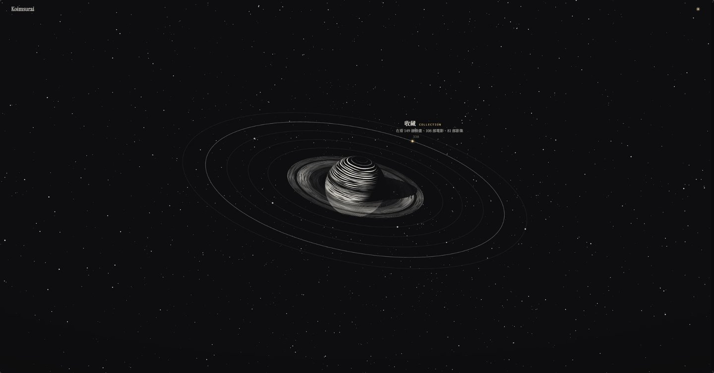](https://koimsurai.com) | [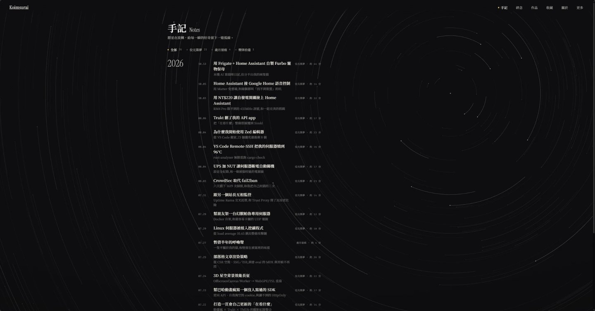](https://koimsurai.com/en/blog) |
| **Article** | **Photos: pictures downlinked from deep space** |
| [](https://koimsurai.com/en/blog) | [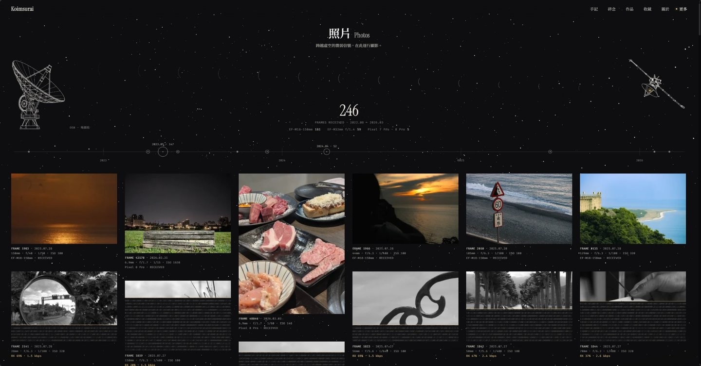](https://koimsurai.com/en/photos) |
| **Works: a spiral course outward** | **Collection: signals sent from Earth** |
| [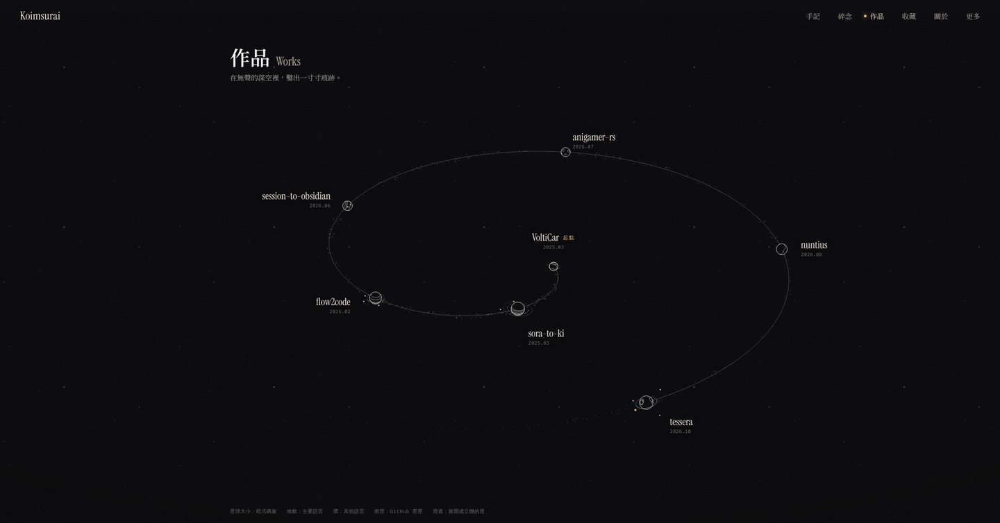](https://koimsurai.com/en/portfolio) | [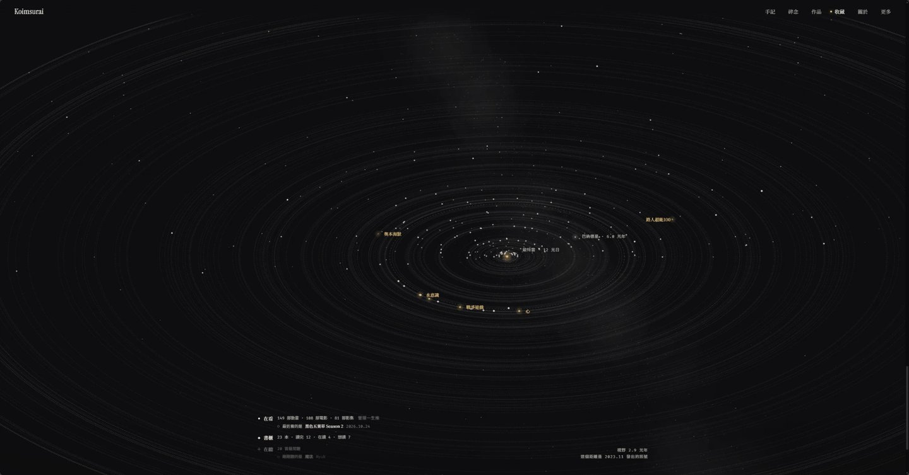](https://koimsurai.com/en/watch) |
| **Friends: stars around one center** | **Log: a launch from the ground** |
| [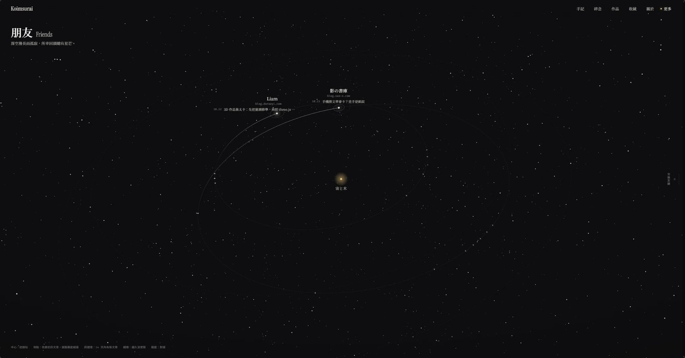](https://koimsurai.com/en/friends) | [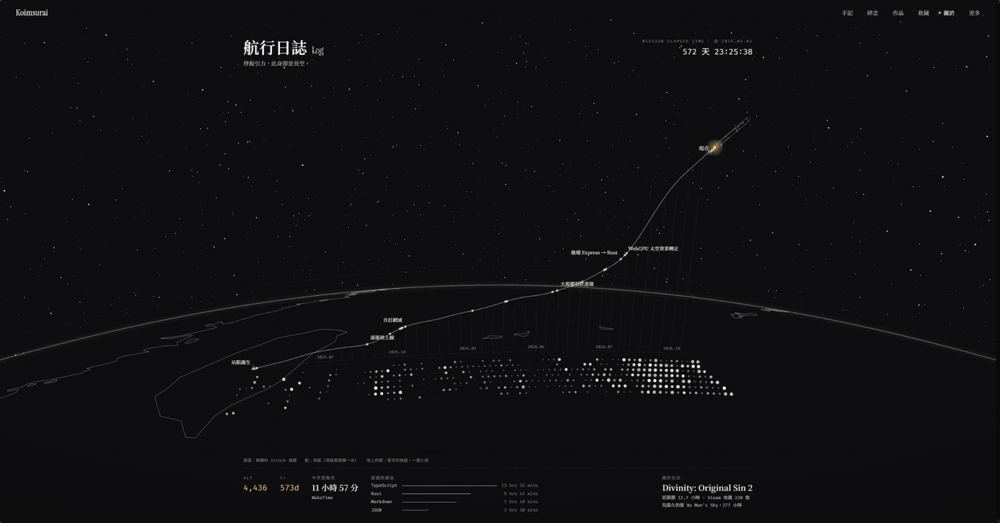](https://koimsurai.com/en/history) |
| **Setup: a spacecraft's blueprints** | **Colophon** |
| [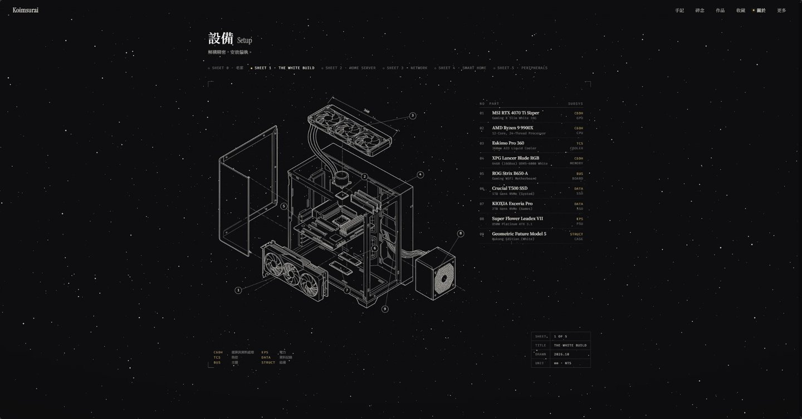](https://koimsurai.com/en/setup) | [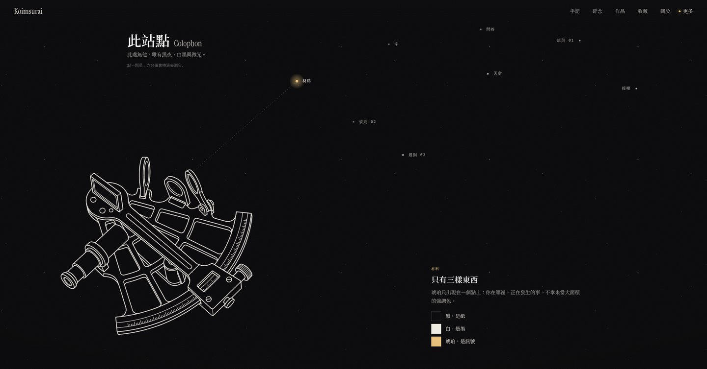](https://koimsurai.com/en/about-site) |

### Admin

| Now | Notes |
|:---:|:---:|
| 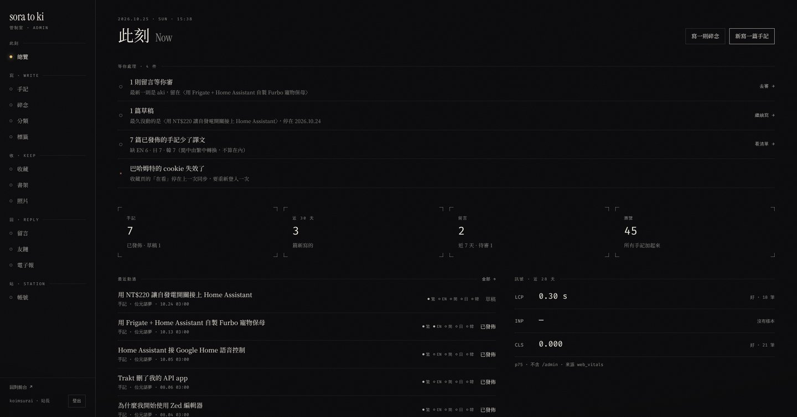 | 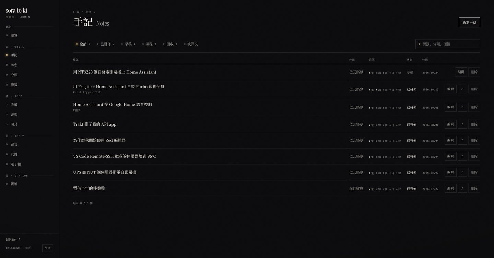 |
| **Moments**: synced records on the right; "Write" pulls one into the composer | **Comments**: list on the left, the selected one on the right; keyboard j / k / a / s / r |
| 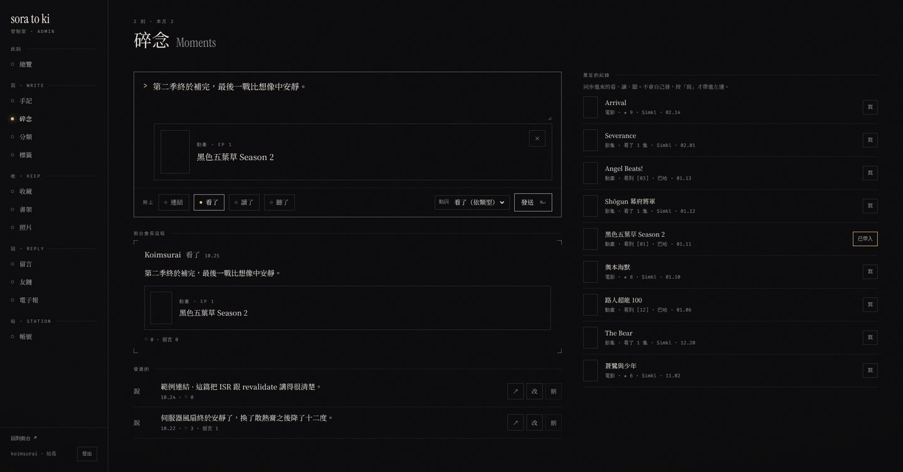 | 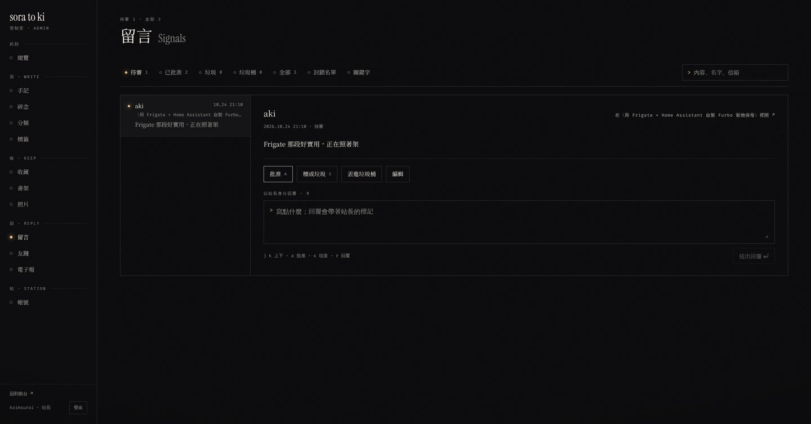 |

## 🚀 The October 2026 rebuild

This wasn't a reskin: the whole site was rebuilt to the three rules above. The previous look is preserved at [`v1-final`](https://github.com/timo9378/sora-to-ki/tree/v1-final).

**Public site**

- The palette went from brand purple, magenta and the Happy Hues set back to the three materials; the green glow on link hover is gone
- Every page draws its own sky (`src/components/*/*Sky.ts`, 2D canvas) from the same dots and lines as the home page's Saturn, and page transitions stitch one sky into the next
- The cursor trail, meteors, UFO and the warp-speed first-visit intro were removed: with that much decoration, "one signal per screen" can't hold
- Type moved to Source Han Serif, subset per page, and every page got its own generated share image

**Admin**

- Rebuilt in the same materials, with the sidebar grouped like the site: Now, Write, Keep, Reply, Station
- Content fills the full width to the right of the sidebar (list pages stay one centred column); changing pages fades the old one out while the new one fades and rises in, and switching tabs does the same
- New features: scheduled publishing, a trash, moments with attached works, link-exchange review, and public-visibility settings for photos and the collection (see "The site itself" below)

**An earlier migration**: in July 2026 the backend moved from Express to Rust in one go. All 120+ endpoints were diffed against the old ones, and the switch happened only once every response matched. The process is written up in [`backend/STRANGLER.md`](backend/STRANGLER.md) (in Chinese).

## ✨ Features

### Notes and moments

- **MDX articles**: GFM plus twenty-odd custom blocks (code tabs, diffs, file trees, charts, polls, Excalidraw sketches, Japanese furigana, spoilers, author's notes…)
- **Five languages**: Traditional Chinese, Simplified Chinese, English, Japanese and Korean. Simplified Chinese is converted automatically with OpenCC; every article can be translated separately
- **Syntax highlighting**: Shiki on its JavaScript regex engine (article pages don't download wasm); Oniguruma is loaded only for C-family languages
- **Mermaid diagrams**: zoom, pan and full screen, themed to match the site
- **No layout shift from images**: a thumbhash and the original dimensions are computed at upload, so a blurred placeholder shows before the image loads
- **Comments, likes, series, table of contents, reading progress**, plus RSS and a newsletter (Resend)
- **Moments**: short posts that can carry a link card, or a film, book or track picked from the synced records, shown as "watched / read / listened to"

### Collection and life log

- **Watching**: Bahamut Anime Crazy history synced automatically ([anigamer](https://github.com/timo9378/anigamer-rs), my own SDK); films and series synced through Simkl and TMDb
- **Music**: Spotify now playing, recently played and favourite genres
- **Bookshelf**: ISBN lookups use Taiwan's National Central Library data
- **Photos**: EXIF details, CLIP auto-tagging and a zoomable full-screen viewer; titles, tags, featured and hidden flags are edited in the admin and survive a NAS re-sync
- **Activity**: WakaTime coding time, GitHub activity, Steam profile and playtime
- **Setup**: the machine's parts and the home network, drawn as engineering sheets

### The site itself

- **Space backdrop**: the starfield and the home page's Saturn are rendered by three.js (WebGPU, falling back to WebGL2) on an OffscreenCanvas inside a Web Worker; devices found to be software-rendering get a pure-CSS version
- **Custom admin**, grouped like the site:
  - **Now**: an overview of what needs attention and the last 28 days of Web Vitals
  - **Write**: Monaco editor (night theme, Vim mode, slash commands, drag-and-drop upload) with live preview; **scheduled publishing** (posts go out on time, and the newsletter is sent then too); deleted posts go to a **trash** first and can be restored for 30 days; for **moments**, the synced records from Bahamut, Simkl, Spotify and the bookshelf are listed alongside, and "Write" pulls one into the composer
  - **Keep**: hide watched titles or played tracks from the public site and arrange the favourites row; the bookshelf; photo titles, tags and featured picks
  - **Reply**: comment moderation (keyboard j / k / a / s / r), **link-exchange requests** (the form on the Friends page submits straight in, with one-click checks that the site is reachable, links back and has an RSS feed), newsletter subscribers
  - **Station**: accounts and roles
- **MCP server**: [`packages/mcp-server`](packages/mcp-server) exposes 27 tools so an AI assistant can write posts (including scheduling and the trash), post moments, upload images and manage categories through the admin API
- **Also**: GitHub / Google sign-in, a command palette (`Ctrl+K`), a PWA offline page, a sitemap and hreflang per language, a strict CSP, self-hosted error tracking (GlitchTip) and Core Web Vitals reporting

## 🏗️ Architecture

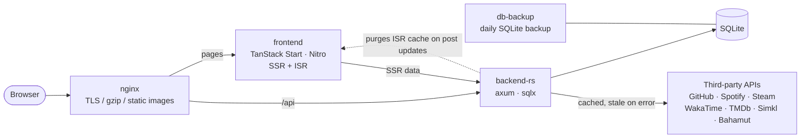

- **Types are written once**: the backend's Rust structs generate TypeScript types with [specta](https://github.com/specta-rs/specta) ([`packages/api-types`](packages/api-types)), which the frontend imports directly; CI checks that both sides match
- **Third-party APIs go through the backend**: keys never reach the frontend. Responses are cached, and stale data is served when an upstream fails, so a section never goes blank
- **ISR**: pages are cached by Nitro, and the backend tells the frontend to purge them when a post changes
- **Design tokens are enforced**: spacing, font sizes, line heights, radii, opacity… must use the tokens in `src/index.css`; `pnpm check:css-tokens` rejects ad-hoc values

## 🛠️ Stack

| | |
|---|---|
| **Frontend** | React 19 · TanStack Start / Router / Query · Vite+ (vite, vitest, oxlint, oxfmt) · Tailwind CSS v4 · Framer Motion · three.js · MDX · Shiki · beautiful-mermaid · Excalidraw · i18next · Radix UI / shadcn |
| **Backend** | Rust 2024 · axum · tokio · sqlx (SQLite) · JWT + bcrypt · image / resvg / thumbhash (images and share images) · ferrous-opencc · utoipa (OpenAPI at `/api/docs`) · Sentry SDK |
| **Type** | Source Han Serif (subset per page) · Instrument Serif · monospace |
| **Infra** | Docker Compose · nginx · GitHub Actions · Codecov · self-hosted GlitchTip |

## 🧪 Quality gates

Every PR has to pass these before it can merge (the full list is in [`.github/workflows/ci.yml`](.github/workflows/ci.yml)):

- **Types and lint**: `tsc`, oxlint (with type-aware rules and `@shadcn/lint`), Biome (CSS), the CSS token check, knip (unused files and exports)
- **Tests**: vitest unit tests; Playwright e2e (21 specs, including accessibility checks, admin round trips, and computed-style comparisons of 11 public routes × 3 widths plus the admin pages); backend cargo-nextest with a coverage threshold
- **API**: Schemathesis generates requests from the OpenAPI spec and checks the responses against the declared schemas
- **Backend**: `cargo clippy` (pedantic), `cargo audit`, `cargo shear`, `typos`
- **Performance**: Lighthouse CI budgets
- **Also** (manual, not in CI): mutation testing (Stryker, cargo-mutants) to find code that tests run through but don't actually check

## ⚙️ Local development

You need **Node.js ≥ 26**, **pnpm 12** and **Rust stable** (edition 2024), or just Docker.

```bash
git clone https://github.com/timo9378/sora-to-ki.git
cd sora-to-ki
pnpm install
```

### Run everything with Docker (easiest)

```bash
cp backend/.env.example .env.backend   # fill in JWT_SECRET
docker compose up -d --build
# → http://localhost:13588
```

### Run frontend and backend separately (for development)

```bash
# Backend: reads backend/.env
cp backend/.env.example backend/.env
#   set DATABASE_URL to a local path, e.g. sqlite://./dev.sqlite
#   set BIND_ADDR to 127.0.0.1:3009 (the frontend dev server's default)
cd backend && cargo run

# Frontend: http://localhost:13998
pnpm dev
```

The database is created if it doesn't exist, and the schema in [`backend/migrations/`](backend/migrations) is applied on startup.

### Environment variables

Only `DATABASE_URL` and `JWT_SECRET` are required (both are in the example file). Anything else that's unset turns the related feature off or shows an empty state.

| Purpose | Variables |
|---|---|
| Basics | `DATABASE_URL` `BIND_ADDR` `JWT_SECRET` `SITE_URL` |
| Admin account | `ADMIN_USERNAME` `ADMIN_PASSWORD` |
| OAuth sign-in | `GITHUB_CLIENT_ID` `GITHUB_CLIENT_SECRET` `GOOGLE_CLIENT_ID` `GOOGLE_CLIENT_SECRET` |
| Activity page | `GITHUB_TOKEN` `WAKATIME_API_KEY` `STEAM_API_KEY` `STEAM_ID` |
| Spotify | `SPOTIFY_CLIENT_ID` `SPOTIFY_CLIENT_SECRET` `SPOTIFY_REFRESH_TOKEN` `SPOTIFY_REDIRECT_URI` |
| Film and TV | `TMDB_API_TOKEN` `SIMKL_CLIENT_ID` `SIMKL_ACCESS_TOKEN` `BAHAMUT_UID` `BAHAMUT_PASSWORD` |
| Bookshelf | `GOOGLE_BOOKS_API_KEY` `ENABLE_TW_ISBN_SYNC` |
| Newsletter | `RESEND_API_KEY` |
| Error tracking | `SENTRY_DSN` `SENTRY_FRONTEND_DSN` |
| ISR purge | `FRONTEND_REVALIDATE_URL` `REVALIDATE_SECRET` |

## 📜 Common commands

```bash
pnpm dev              # frontend dev server
pnpm build            # production build
pnpm test             # unit tests
pnpm e2e              # Playwright e2e (runs the last build; run pnpm build after changing src/)
pnpm lint:css         # CSS lint (Biome)
pnpm check:css-tokens # CSS token check
pnpm export:types     # regenerate TS types from Rust

cd backend
cargo nextest run --no-fail-fast   # backend tests (use nextest, not cargo test)
cargo clippy --all-targets -- -D warnings
```

## 📂 Project layout

```
.
├── backend/                 # Rust API
│   ├── src/router.rs        # route table
│   ├── src/handlers/        # split by domain (posts, thoughts, watch, gallery, spotify…)
│   ├── migrations/          # SQLite schema
│   └── STRANGLER.md         # Express → Rust migration log
├── packages/
│   ├── api-types/           # TS types generated from Rust (don't edit by hand)
│   ├── mdx-core/            # MDX compile settings shared by frontend and backend
│   └── mcp-server/          # MCP server for the admin API
├── src/
│   ├── routes/              # TanStack Router file routes (including the $locale/ prefix)
│   ├── components/          # grouped by feature; each page's sky is in a matching *Sky.ts
│   ├── data/ i18n/ seo/     # API queries, locale routing, meta and JSON-LD
│   ├── hooks/ store/ lib/
│   └── locales/             # translations for the five languages
├── server/routes/           # Nitro routes: sitemap, robots, rss, llms.txt
├── tests/e2e/               # Playwright
├── Dockerfile
└── docker-compose.yml
```

Working notes for AI assistants (Claude Code and the like) live in [`CLAUDE.md`](CLAUDE.md) (in Chinese); it also records a lot of past pitfalls and the reasons behind design decisions.

## 🍴 Borrowing or forking

Feel free to borrow any of the code or fork it to run your own site. A few things first:

- The code is **AGPL-3.0**: if you modify it and **run it as a public website**, you have to publish your modified source under the same licence
- The site's **articles, photos, moments, avatar and logo are not covered by the licence** (see below); replace them with your own after forking
- A lot of content is tied to my accounts: Steam / GitHub / WakaTime on the activity page, the Bahamut sync, the introductions on the home and about pages, and the hardware list on the setup page. Change these to your own or remove them
- If you want the pre-rebuild version, start from the tag [`v1-final`](https://github.com/timo9378/sora-to-ki/tree/v1-final)
- Questions and bug reports are welcome as [issues](https://github.com/timo9378/sora-to-ki/issues)

## 📄 License

- **Code**: [GNU Affero General Public License v3.0](LICENSE)
- **Content**: articles, photos, moments, book reviews, the avatar, the logo and other site content © Koimsurai, **all rights reserved**; please don't republish or reproduce them without permission

## 🙏 Thanks

The site relies on a lot of open source, with special thanks to
[TanStack](https://tanstack.com/), [axum](https://github.com/tokio-rs/axum), [sqlx](https://github.com/launchbadge/sqlx),
[three.js](https://threejs.org/), [Shiki](https://shiki.style/), [MDX](https://mdxjs.com/),
[Excalidraw](https://excalidraw.com/), [Radix UI](https://www.radix-ui.com/), [shadcn/ui](https://ui.shadcn.com/),
[OpenCC](https://github.com/BYVoid/OpenCC), [thumbhash](https://github.com/evanw/thumbhash),
[Source Han Serif](https://github.com/adobe-fonts/source-han-serif), [Instrument Serif](https://fonts.google.com/specimen/Instrument+Serif),
and the [Vite+](https://viteplus.dev/) and oxc toolchain.

## 🌌 More

- Colophon (the full design write-up): <https://koimsurai.com/en/about-site>
- The road the site has taken: <https://koimsurai.com/en/history>
- The old site (v1, read-only): <https://archive.koimsurai.com>
- Link exchange (apply with the form on the page): <https://koimsurai.com/en/friends>
