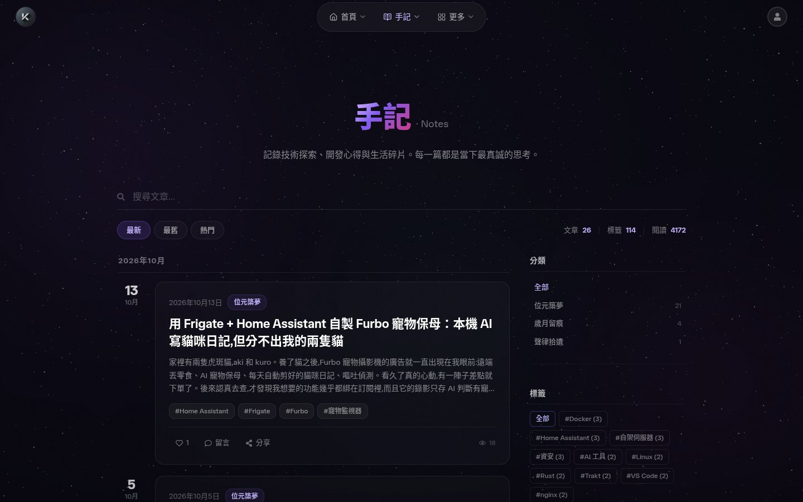
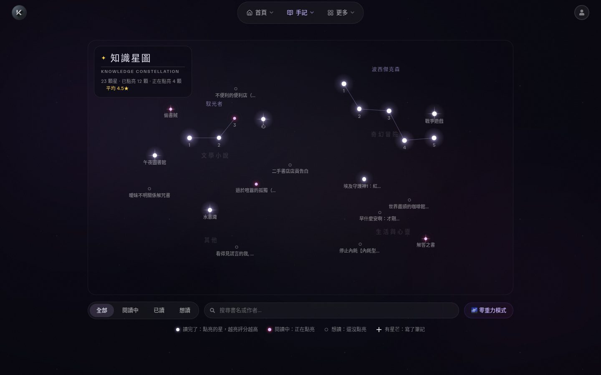
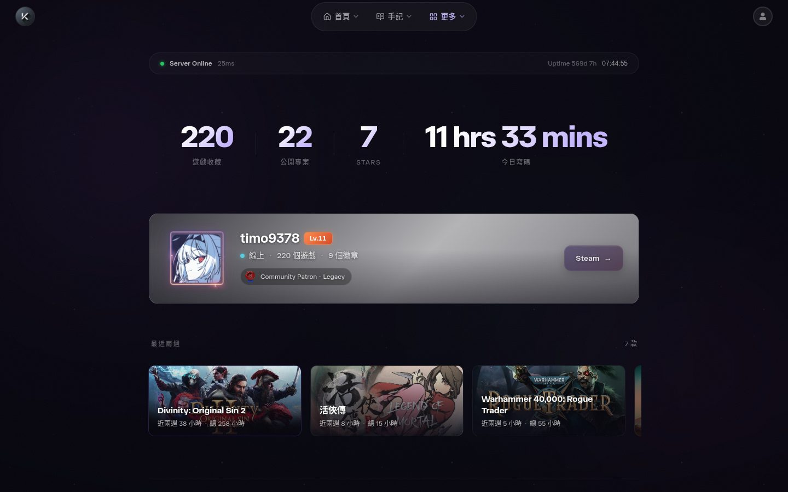

<div align="center">


# 宙と木 · Koimsurai

**A personal site and blog**: technical notes, photos and a reading list, with my games, music, anime and coding activity gathered in one place.

[繁體中文](README.md) · **English**

[**koimsurai.com**](https://koimsurai.com) · [Notes](https://koimsurai.com/en/blog) · [RSS](https://koimsurai.com/rss) · [Site history](https://koimsurai.com/en/history)

[](https://github.com/timo9378/sora-to-ki/actions/workflows/ci.yml)
[](LICENSE)
[](https://app.codecov.io/gh/timo9378/sora-to-ki?flags%5B0%5D=frontend)
[](https://app.codecov.io/gh/timo9378/sora-to-ki?flags%5B0%5D=e2e)
[](https://app.codecov.io/gh/timo9378/sora-to-ki?flags%5B0%5D=backend)

[](https://react.dev/)
[](https://tanstack.com/start)
[](https://github.com/tokio-rs/axum)
[](https://sqlite.org/)
[](https://docs.docker.com/compose/)

</div>

---

Started in April 2025 and still evolving. The frontend is **React 19 + TanStack Start (SSR + ISR)**, the backend is **Rust (axum + sqlx + SQLite)**, and everything runs on a server at home, deployed with Docker Compose.

> In July 2026 the backend moved from Express to Rust in one go: all 120+ endpoints were diffed against the old ones, and the switch happened only once every response matched byte for byte. The process is written up in [`backend/STRANGLER.md`](backend/STRANGLER.md) (in Chinese).

## 📸 Screenshots

| Home | Notes |
|:---:|:---:|
| [](https://koimsurai.com) | [](https://koimsurai.com/en/blog) |
| **Article** | **Bookshelf (star map)** |
| [](https://koimsurai.com/en/blog) | [](https://koimsurai.com/en/bookshelf) |
| **Setup** | **Activity** |
| [](https://koimsurai.com/en/setup) | [](https://koimsurai.com/en/activity) |

## ✨ Features

### Notes (the blog)

- **MDX articles**: GFM plus twenty-odd custom blocks (code tabs, diffs, file trees, charts, polls, Excalidraw sketches, Japanese furigana, spoilers, author's notes…)
- **Five languages**: Traditional Chinese, Simplified Chinese, English, Japanese and Korean. Simplified Chinese is converted automatically with OpenCC; every article can be translated separately
- **Syntax highlighting**: Shiki on its JavaScript regex engine (article pages don't download wasm); Oniguruma is loaded only for C-family languages
- **Mermaid diagrams**: zoom, pan and full screen, themed to match the site
- **No layout shift from images**: a thumbhash and the original dimensions are computed at upload, so a blurred placeholder shows before the image loads
- **Comments, likes, reactions, series, table of contents, reading progress**, plus RSS and a newsletter (Resend)
- **Moments**: short posts that can carry a link card, or a film, book or track picked from the synced records, shown as "watched / read / listened to" (translated in all five languages)

### Life log

- **Activity**: WakaTime coding time, GitHub activity, Steam profile and playtime
- **Music**: Spotify now playing, recently played and favourite genres
- **Watching**: Bahamut Anime Crazy history synced automatically ([anigamer](https://github.com/timo9378/anigamer-rs), my own SDK); films and series synced through Simkl and TMDb
- **Bookshelf**: books laid out as a star map; ISBN lookups use Taiwan's National Central Library data, with a draggable 3D zero-gravity mode
- **Photos**: masonry layout, EXIF details, CLIP auto-tagging and a zoomable full-screen viewer; titles, tags, featured and hidden flags are edited in the admin and survive a NAS re-sync
- **Setup**: neofetch-style host info in a terminal UI, plus the home network topology

### The site itself

- **Space backdrop**: the starfield and Saturn are rendered by three.js (WebGPU, falling back to WebGL2) on an OffscreenCanvas inside a Web Worker; devices without a GPU get a pure-CSS version
- **Custom admin**: built from the same materials as the public site (black is paper, white is ink, amber is signal), with the sidebar grouped like the site: Now, Write, Keep, Reply, Station
  - **Write**: Monaco editor (night theme, Vim mode, slash commands, drag-and-drop upload) with live preview; **scheduled publishing** (posts go out on time, and the newsletter is sent then too); deleted posts go to a **trash** first and can be restored for 30 days
  - **Moments**: the synced records from Bahamut, Simkl, Spotify and the bookshelf are listed alongside; "Write" pulls one into the composer, and a post with an attachment can skip the text
  - **Keep**: hide watched titles or played tracks from the public site and arrange the favourites row; the bookshelf; photo titles, tags and featured picks
  - **Reply**: comment moderation (keyboard j / k / a / s / r), **link-exchange requests** (the form on the Friends page submits straight in, with one-click checks that the site is reachable, links back and has an RSS feed), newsletter subscribers
  - **Now**: an overview of what needs attention and the last 28 days of Web Vitals
- **MCP server**: [`packages/mcp-server`](packages/mcp-server) exposes 27 tools so an AI assistant can write posts (including scheduling and the trash), post moments, upload images and manage categories through the admin API
- **Also**: GitHub / Google sign-in, a command palette (`Ctrl+K`), a PWA offline page, a sitemap and hreflang per language, generated OG images for articles, a strict CSP, self-hosted error tracking (GlitchTip) and Core Web Vitals reporting

## 🏗️ Architecture


- **Types are written once**: the backend's Rust structs generate TypeScript types with [specta](https://github.com/specta-rs/specta) ([`packages/api-types`](packages/api-types)), which the frontend imports directly; CI checks that both sides match
- **Third-party APIs go through the backend**: keys never reach the frontend. Responses are cached, and stale data is served when an upstream fails, so a section never goes blank
- **ISR**: pages are cached by Nitro, and the backend tells the frontend to purge them when a post changes

## 🛠️ Stack

| | |
|---|---|
| **Frontend** | React 19 · TanStack Start / Router / Query · Vite+ (vite, vitest, oxlint, oxfmt) · Tailwind CSS v4 · Framer Motion · three.js · MDX · Shiki · beautiful-mermaid · Excalidraw · i18next · Radix UI / shadcn |
| **Backend** | Rust 2024 · axum · tokio · sqlx (SQLite) · JWT + bcrypt · image / resvg / thumbhash (images and OG images) · ferrous-opencc · utoipa (OpenAPI at `/api/docs`) · Sentry SDK |
| **Infra** | Docker Compose · nginx · GitHub Actions · Codecov · self-hosted GlitchTip |

## 🧪 Quality gates

Every PR has to pass these before it can merge (the full list is in [`.github/workflows/ci.yml`](.github/workflows/ci.yml)):

- **Types and lint**: `tsc`, oxlint (with type-aware rules and `@shadcn/lint`), Biome (CSS), and a home-grown CSS token check (spacing, font sizes, colours… all have to use design tokens)
- **Tests**: vitest unit tests; Playwright e2e (21 specs, including accessibility checks, admin round trips, and computed-style comparisons of 11 public routes × 3 widths plus the admin pages); backend cargo-nextest with a coverage threshold
- **API**: Schemathesis generates requests from the OpenAPI spec and checks the responses against the declared schemas
- **Backend**: `cargo clippy` (pedantic), `cargo audit`, `cargo shear`, `typos`
- **Performance**: Lighthouse CI budgets
- **Also** (manual, not in CI): mutation testing (Stryker, cargo-mutants) to find code that tests run through but don't actually check

## ⚙️ Local development

You need **Node.js ≥ 26**, **pnpm 12** and **Rust stable** (edition 2024), or just Docker.

```bash
git clone https://github.com/timo9378/sora-to-ki.git
cd sora-to-ki
pnpm install
```

### Run everything with Docker (easiest)

```bash
cp backend/.env.example .env.backend   # fill in JWT_SECRET
docker compose up -d --build
# → http://localhost:13588
```

### Run frontend and backend separately (for development)

```bash
# Backend: reads backend/.env
cp backend/.env.example backend/.env
#   set DATABASE_URL to a local path, e.g. sqlite://./dev.sqlite
#   set BIND_ADDR to 127.0.0.1:3009 (the frontend dev server's default)
cd backend && cargo run

# Frontend: http://localhost:13998
pnpm dev
```

The database is created if it doesn't exist, and the schema in [`backend/migrations/`](backend/migrations) is applied on startup.

### Environment variables

Only `DATABASE_URL` and `JWT_SECRET` are required (both are in the example file). Anything else that's unset turns the related feature off or shows an empty state.

| Purpose | Variables |
|---|---|
| Basics | `DATABASE_URL` `BIND_ADDR` `JWT_SECRET` `SITE_URL` |
| Admin account | `ADMIN_USERNAME` `ADMIN_PASSWORD` |
| OAuth sign-in | `GITHUB_CLIENT_ID` `GITHUB_CLIENT_SECRET` `GOOGLE_CLIENT_ID` `GOOGLE_CLIENT_SECRET` |
| Activity page | `GITHUB_TOKEN` `WAKATIME_API_KEY` `STEAM_API_KEY` `STEAM_ID` |
| Spotify | `SPOTIFY_CLIENT_ID` `SPOTIFY_CLIENT_SECRET` `SPOTIFY_REFRESH_TOKEN` `SPOTIFY_REDIRECT_URI` |
| Film and TV | `TMDB_API_TOKEN` `SIMKL_CLIENT_ID` `SIMKL_ACCESS_TOKEN` `BAHAMUT_UID` `BAHAMUT_PASSWORD` |
| Bookshelf | `GOOGLE_BOOKS_API_KEY` `ENABLE_TW_ISBN_SYNC` |
| Newsletter | `RESEND_API_KEY` |
| Error tracking | `SENTRY_DSN` `SENTRY_FRONTEND_DSN` |
| ISR purge | `FRONTEND_REVALIDATE_URL` `REVALIDATE_SECRET` |

## 📜 Common commands

```bash
pnpm dev              # frontend dev server
pnpm build            # production build
pnpm test             # unit tests
pnpm e2e              # Playwright e2e (runs the last build; run pnpm build after changing src/)
pnpm lint:css         # CSS lint (Biome)
pnpm check:css-tokens # CSS token check
pnpm export:types     # regenerate TS types from Rust

cd backend
cargo nextest run --no-fail-fast   # backend tests (use nextest, not cargo test)
cargo clippy --all-targets -- -D warnings
```

## 📂 Project layout

```
.
├── backend/                 # Rust API
│   ├── src/router.rs        # route table
│   ├── src/handlers/        # split by domain (posts, thoughts, watch, gallery, spotify…)
│   ├── migrations/          # SQLite schema
│   └── STRANGLER.md         # Express → Rust migration log
├── packages/
│   ├── api-types/           # TS types generated from Rust (don't edit by hand)
│   ├── mdx-core/            # MDX compile settings shared by frontend and backend
│   └── mcp-server/          # MCP server for the admin API
├── src/
│   ├── routes/              # TanStack Router file routes (including the $locale/ prefix)
│   ├── components/          # grouped by feature: layout, backdrop, blog, mdx, media, admin…
│   ├── data/ i18n/ seo/     # API queries, locale routing, meta and JSON-LD
│   ├── hooks/ store/ lib/
│   └── locales/             # translations for the five languages
├── server/routes/           # Nitro routes: sitemap, robots, rss, llms.txt
├── tests/e2e/               # Playwright
├── Dockerfile
└── docker-compose.yml
```

Working notes for AI assistants (Claude Code and the like) live in [`CLAUDE.md`](CLAUDE.md) (in Chinese); it also records a lot of past pitfalls and the reasons behind design decisions.

## 🍴 Borrowing or forking

Feel free to borrow any of the code or fork it to run your own site. A few things first:

- The code is **AGPL-3.0**: if you modify it and **run it as a public website**, you have to publish your modified source under the same licence
- The site's **articles, photos, moments, avatar and logo are not covered by the licence** (see below); replace them with your own after forking
- A lot of content is tied to my accounts: Steam / GitHub / WakaTime on the activity page, the Bahamut sync, the introductions on the home and about pages, and the hardware list on the setup page. Change these to your own or remove them
- Questions and bug reports are welcome as [issues](https://github.com/timo9378/sora-to-ki/issues)

## 📄 License

- **Code**: [GNU Affero General Public License v3.0](LICENSE)
- **Content**: articles, photos, moments, book reviews, the avatar, the logo and other site content © Koimsurai, **all rights reserved**; please don't republish or reproduce them without permission

## 🙏 Thanks

The site relies on a lot of open source, with special thanks to
[TanStack](https://tanstack.com/), [axum](https://github.com/tokio-rs/axum), [sqlx](https://github.com/launchbadge/sqlx),
[three.js](https://threejs.org/), [Shiki](https://shiki.style/), [MDX](https://mdxjs.com/),
[Excalidraw](https://excalidraw.com/), [Radix UI](https://www.radix-ui.com/), [shadcn/ui](https://ui.shadcn.com/),
[OpenCC](https://github.com/BYVoid/OpenCC), [thumbhash](https://github.com/evanw/thumbhash),
and the [Vite+](https://viteplus.dev/) and oxc toolchain.

## 🌌 More

- The road the site has taken: <https://koimsurai.com/en/history>
- About this site: <https://koimsurai.com/en/about-site>
- Link exchange (apply with the form on the page): <https://koimsurai.com/en/friends>
