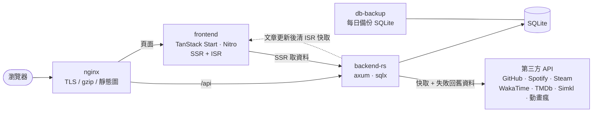

<div align="center">


# 宙と木 · Koimsurai

**此處無他，唯有黑夜、白墨與微光。**

一個人的網站：寫技術手記、發碎念、放照片與書單，也把看的、聽的、寫的程式串在同一片天空裡。

**繁體中文** · [English](README.en.md)

[**koimsurai.com**](https://koimsurai.com) · [手記](https://koimsurai.com/blog) · [此站點](https://koimsurai.com/about-site) · [航行日誌](https://koimsurai.com/history) · [RSS](https://koimsurai.com/rss)

[](https://github.com/timo9378/sora-to-ki/actions/workflows/ci.yml)
[](LICENSE)
[](https://app.codecov.io/gh/timo9378/sora-to-ki?flags%5B0%5D=frontend)
[](https://app.codecov.io/gh/timo9378/sora-to-ki?flags%5B0%5D=e2e)
[](https://app.codecov.io/gh/timo9378/sora-to-ki?flags%5B0%5D=backend)

[](https://react.dev/)
[](https://tanstack.com/start)
[](https://github.com/tokio-rs/axum)
[](https://sqlite.org/)
[](https://docs.docker.com/compose/)

</div>

---

從 2025 年 4 月開始寫，一路改到現在。前端是 **React 19 + TanStack Start（SSR + ISR）**，後端是 **Rust（axum + sqlx + SQLite）**，全部跑在家裡的一台伺服器上，用 Docker Compose 部署。

> **想看舊站？** 2026 年 10 月整站翻新成現在的「宙と木」。翻新前的最後一版留在 tag [`v1-final`](https://github.com/timo9378/sora-to-ki/tree/v1-final)（`git checkout v1-final`），也還跑在 <https://archive.koimsurai.com>（唯讀）。

## 🌌 設計

整個站只有一個概念：**每一頁都是同一片夜空裡的一種東西**，用首頁那顆點線土星的點和線變出來。完整的說明（還能一步一步看土星怎麼畫出來）在站上的 [此站點](https://koimsurai.com/about-site)。

### 只有三樣材料

| | | |
|---|---|---|
| ⬛ | **黑，是紙** | 整個站的底 |
| ⬜ | **白，是墨** | 字、線、點 |
| 🟧 | **琥珀，是訊號** | 只出現在一個點上：你在哪裡、正在發生的事。不拿來當大面積的強調色 |

### 三種字

- **思源宋體**：中文與所有混排的句子。按頁面實際用到的字裁切，一頁只下載幾十 KB
- **Instrument Serif**：只給整段英文的大字，不加粗
- **等寬字**：日期與數字

讀文章時還能換成黑體、楷體或現代無襯線，四種都照語系由站上提供。

### 三條規則

1. **一個畫面只有一個訊號**：琥珀色一次只亮一處
2. **只用點與線**：不塗色塊、不疊陰影、不用毛玻璃；直角、細線、點線分隔
3. **由數據長出來**：作品頁的星球大小是程式碼量、地貌是主要語言、衛星是 GitHub 星星

### 同一片天空

| 頁面 | 是天空裡的 |
|---|---|
| 首頁 | 繞著土星的衛星（五顆衛星對應五個分區） |
| 手記 | 一圈一圈的星軌，一篇文章就是一道 |
| 碎念 | 劃過的彗星，最新那則是彗核 |
| 作品 | 往外長的螺旋航線 |
| 收藏 | 從地球發出的訊號：看完、讀完、聽完的那一刻發出，以光速飛到現在，距離就是離現在多久 |
| 照片 | 從深空傳回來的照片，一行一行收下來 |
| 設備 | 太空船的工程圖 |
| 朋友 | 繞著同一個中心的星 |
| 留言 | 收到的電波 |
| 航行日誌 | 從地表升空 |
| 關於 | 一次下墜 |

## 📸 畫面

| 首頁：繞著土星的衛星 | 手記：一圈一圈的星軌 |
|:---:|:---:|
| [](https://koimsurai.com) | [](https://koimsurai.com/blog) |
| **文章** | **作品：往外長的螺旋航線** |
| [](https://koimsurai.com/blog) | [](https://koimsurai.com/portfolio) |
| **收藏：從地球發出的訊號** | **航行日誌：從地表升空** |
| [](https://koimsurai.com/watch) | [](https://koimsurai.com/history) |
| **設備：太空船的工程圖** | **此站點** |
| [](https://koimsurai.com/setup) | [](https://koimsurai.com/about-site) |

### 後台

| 此刻 | 手記 |
|:---:|:---:|
|  |  |
| **碎念**：右邊是同步進來的紀錄，按「寫」帶進左邊 | **留言**：左邊清單、右邊那一則，鍵盤 j／k／a／s／r |
|  |  |

## 🚀 2026-10 的大遷移

這次不是換皮，是把整個站照上面的三條規則重新做一遍。舊版的樣子在 [`v1-final`](https://github.com/timo9378/sora-to-ki/tree/v1-final)。

**前台**

- 配色從品牌紫、洋紅、Happy Hues 那套收回到三樣材料；連結滑過變綠發光那條拿掉
- 每一頁各畫各的天空（`src/components/*/*Sky.ts`，2D canvas），共用首頁那顆土星的點與線；換頁時用轉場把兩片天空接起來
- 拿掉游標尾巴、流星、UFO 與首訪的高速穿越開場：裝飾一多，「一個畫面只有一個訊號」就不成立
- 字換成思源宋體並按頁裁字；每一頁有自己的動態分享圖

**後台**

- 換成跟前台同一套材料，側欄照前台的分區分成「此刻、寫、收、回、站」
- 內容撐滿側欄右邊的寬度（清單類的頁面收成一欄置中）；換頁時舊畫面淡出、新的那頁淡入上浮，切分頁也一樣
- 新功能：排程發佈、回收桶、碎念附作品、友鏈申請審核、照片與收藏的前台顯示設定（見下面「站台本身」）

**更早的一次遷移**：2026-07 後端從 Express 整套搬到 Rust，120 多個端點逐一對拍、確認回應一模一樣才切換。過程記錄在 [`backend/STRANGLER.md`](backend/STRANGLER.md)。

## ✨ 有什麼

### 手記與碎念

- **MDX 文章**：除了 GFM，另有二十多個自訂區塊（程式碼分頁、Diff、檔案樹、圖表、投票、Excalidraw 手繪圖、日文振假名、劇透、站長註解…）
- **五種語系**：繁中、簡中、English、日本語、한국어。簡中用 OpenCC 自動轉換，每篇文章可以各自翻譯
- **程式碼高亮**：Shiki 走 JavaScript 正規式引擎（文章頁不用下載 wasm），只有 C 家族語言才載入 Oniguruma
- **Mermaid 圖表**：可縮放、平移、全螢幕，跟著站點配色
- **圖片不跳版**：上傳時算出 thumbhash 和原始尺寸，載入前先顯示模糊佔位圖
- **留言、按讚、系列文、目錄、閱讀進度**，以及 RSS、電子報（Resend）
- **碎念**：短篇動態，可以附上連結卡片，或從同步進來的紀錄帶入一部片、一本書、一首歌，前台寫成「看了／讀了／聽了」

### 收藏與生活紀錄

- **在看什麼**：動畫瘋觀看紀錄自動同步（[anigamer](https://github.com/timo9378/anigamer-rs)，自己寫的 SDK），電影與影集透過 Simkl 和 TMDb 同步
- **音樂**：Spotify 正在播放、最近播放、最愛曲風
- **書櫃**：ISBN 查詢走國家圖書館的資料
- **照片**：EXIF 資訊、CLIP 自動標籤、可縮放的全螢幕檢視；標題、標籤、精選與隱藏在後台改，NAS 重新同步不會蓋掉
- **動態**：WakaTime 寫程式時數、GitHub 活動、Steam 個人檔案與遊戲時數
- **設備**：主機的零件與家裡的網路拓樸，畫成工程圖

### 站台本身

- **太空背景**：星空與首頁的土星由 three.js（WebGPU，不支援時退回 WebGL2）在 Web Worker 的 OffscreenCanvas 裡算；偵測到軟體渲染的裝置自動改成純 CSS
- **自製後台**，照前台的分區：
  - **此刻**：總覽列出等你處理的事、近 28 天的 Web Vitals
  - **寫**：Monaco 編輯器（夜色主題、Vim 模式、斜線指令、拖放上傳）與即時預覽；**排程發佈**（到時間自動發，電子報也那時才寄）；刪掉的文章先進**回收桶**，30 天內可以還原；**碎念**的右邊列出巴哈、Simkl、Spotify、書架同步進來的紀錄，按「寫」帶進撰寫框
  - **收**：觀看紀錄與聽的歌可以設成不公開、排收藏頁的最愛；書架；照片的標題、標籤、精選
  - **回**：留言審核（鍵盤 j／k／a／s／r 操作）、**友鏈申請**（朋友頁的表單直接送進來，一鍵檢查對方的站連得到、有沒有回連、有沒有 RSS）、電子報訂閱者
  - **站**：帳號與權限
- **MCP server**：[`packages/mcp-server`](packages/mcp-server) 提供 27 個工具，讓 AI 助手透過後台 API 寫文章（含排程與回收桶）、發碎念、上傳圖片、管理分類
- **其他**：GitHub／Google 登入、命令面板（`Ctrl+K`）、PWA 離線頁、每語系各自的 sitemap 與 hreflang、嚴格的 CSP、自架的錯誤追蹤（GlitchTip）與 Core Web Vitals 回報

## 🏗️ 架構



- **型別只寫一次**：後端的 Rust struct 用 [specta](https://github.com/specta-rs/specta) 產生 TypeScript 型別（[`packages/api-types`](packages/api-types)），前端直接引用；CI 會檢查兩邊有沒有對上
- **第三方 API 都經過後端**：金鑰不會進前端。回應會快取，上游出錯時改回舊資料，不會整區空白
- **ISR**：頁面由 Nitro 快取，後端改到文章時主動通知前端清除快取
- **設計 token 有檢查在擋**：間距、字級、行高、圓角、透明度…都必須用 `src/index.css` 裡的 token，`pnpm check:css-tokens` 會擋掉現編的值

## 🛠️ 技術

| | |
|---|---|
| **前端** | React 19 · TanStack Start / Router / Query · Vite+（vite、vitest、oxlint、oxfmt）· Tailwind CSS v4 · Framer Motion · three.js · MDX · Shiki · beautiful-mermaid · Excalidraw · i18next · Radix UI / shadcn |
| **後端** | Rust 2024 · axum · tokio · sqlx（SQLite）· JWT + bcrypt · image / resvg / thumbhash（圖片與分享圖）· ferrous-opencc · utoipa（OpenAPI，`/api/docs`）· Sentry SDK |
| **字** | 思源宋體（按頁裁字）· Instrument Serif · 等寬字 |
| **基礎設施** | Docker Compose · nginx · GitHub Actions · Codecov · 自架 GlitchTip |

## 🧪 品質把關

每個 PR 都要通過下面這些才能合併（完整清單在 [`.github/workflows/ci.yml`](.github/workflows/ci.yml)）：

- **型別與 lint**：`tsc`、oxlint（含型別感知規則與 `@shadcn/lint`）、Biome（CSS）、CSS token 檢查、knip（沒用到的檔案與 export）
- **測試**：vitest 單元測試、Playwright e2e（21 支 spec，含無障礙檢查、後台的往返操作，以及公開頁 11 條 × 3 種寬度加上後台頁的計算後樣式比對）、後端 cargo-nextest 搭配覆蓋率門檻
- **API**：用 OpenAPI 規格自動產生測試資料打後端（Schemathesis），並檢查回應符合宣告的 schema
- **後端**：`cargo clippy`（pedantic）、`cargo audit`、`cargo shear`、`typos`
- **效能**：Lighthouse CI 的效能預算
- **另外**（不在 CI，手動跑）：變異測試（Stryker、cargo-mutants），找出「測試有跑到、但其實沒在檢查」的地方

## ⚙️ 本機開發

需要 **Node.js ≥ 26**、**pnpm 12**、**Rust stable**（edition 2024），或者只要 Docker。

```bash
git clone https://github.com/timo9378/sora-to-ki.git
cd sora-to-ki
pnpm install
```

### 用 Docker 跑整套（最簡單）

```bash
cp backend/.env.example .env.backend   # 填上 JWT_SECRET
docker compose up -d --build
# → http://localhost:13588
```

### 分開跑前後端（開發用）

```bash
# 後端：讀 backend/.env
cp backend/.env.example backend/.env
#   把 DATABASE_URL 改成本機路徑，例如 sqlite://./dev.sqlite
#   把 BIND_ADDR 改成 127.0.0.1:3009（前端 dev server 預設連這個埠）
cd backend && cargo run

# 前端：http://localhost:13998
pnpm dev
```

資料庫不存在時會自動建立，schema 由 [`backend/migrations/`](backend/migrations) 在啟動時套用。

### 環境變數

必填的只有 `DATABASE_URL` 和 `JWT_SECRET`（範例檔裡都有）。其他的沒設時，對應的功能會自動關閉，或顯示空狀態。

| 用途 | 變數 |
|---|---|
| 基本 | `DATABASE_URL` `BIND_ADDR` `JWT_SECRET` `SITE_URL` |
| 後台帳號 | `ADMIN_USERNAME` `ADMIN_PASSWORD` |
| OAuth 登入 | `GITHUB_CLIENT_ID` `GITHUB_CLIENT_SECRET` `GOOGLE_CLIENT_ID` `GOOGLE_CLIENT_SECRET` |
| 動態頁 | `GITHUB_TOKEN` `WAKATIME_API_KEY` `STEAM_API_KEY` `STEAM_ID` |
| Spotify | `SPOTIFY_CLIENT_ID` `SPOTIFY_CLIENT_SECRET` `SPOTIFY_REFRESH_TOKEN` `SPOTIFY_REDIRECT_URI` |
| 影劇 | `TMDB_API_TOKEN` `SIMKL_CLIENT_ID` `SIMKL_ACCESS_TOKEN` `BAHAMUT_UID` `BAHAMUT_PASSWORD` |
| 書櫃 | `GOOGLE_BOOKS_API_KEY` `ENABLE_TW_ISBN_SYNC` |
| 電子報 | `RESEND_API_KEY` |
| 錯誤追蹤 | `SENTRY_DSN` `SENTRY_FRONTEND_DSN` |
| ISR 清快取 | `FRONTEND_REVALIDATE_URL` `REVALIDATE_SECRET` |

## 📜 常用指令

```bash
pnpm dev              # 前端 dev server
pnpm build            # 正式建置
pnpm test             # 單元測試
pnpm e2e              # Playwright e2e（跑的是上一次 build 的產物，改完 src/ 要先 build）
pnpm lint:css         # CSS lint（Biome）
pnpm check:css-tokens # CSS token 檢查
pnpm export:types     # 從 Rust 重新產生 TS 型別

cd backend
cargo nextest run --no-fail-fast   # 後端測試（請用 nextest，不要用 cargo test）
cargo clippy --all-targets -- -D warnings
```

## 📂 專案結構

```
.
├── backend/                 # Rust API
│   ├── src/router.rs        # 路由表
│   ├── src/handlers/        # 依領域拆分（posts、thoughts、watch、gallery、spotify…）
│   ├── migrations/          # SQLite schema
│   └── STRANGLER.md         # Express → Rust 遷移紀錄
├── packages/
│   ├── api-types/           # 由 Rust 產生的 TS 型別（不要手改）
│   ├── mdx-core/            # 前後端共用的 MDX 編譯設定
│   └── mcp-server/          # 後台 API 的 MCP server
├── src/
│   ├── routes/              # TanStack Router 的檔案路由（含 $locale/ 語系前綴）
│   ├── components/          # 依功能領域分組；各頁的天空在同名的 *Sky.ts
│   ├── data/ i18n/ seo/     # API 查詢、語系路由、meta 與 JSON-LD
│   ├── hooks/ store/ lib/
│   └── locales/             # 五種語系的翻譯
├── server/routes/           # Nitro 路由：sitemap、robots、rss、llms.txt
├── tests/e2e/               # Playwright
├── Dockerfile
└── docker-compose.yml
```

給 AI 助手（Claude Code 等）看的工作守則在 [`CLAUDE.md`](CLAUDE.md)，裡面也記錄了很多踩過的坑和設計理由。

## 🍴 想參考或拿去改

歡迎參考任何寫法，或直接 fork 來架自己的站。幾件事先說：

- 程式碼採 **AGPL-3.0**：如果你改過之後**架成網站對外提供**，也要以相同授權公開修改後的原始碼
- 站上的**文章、照片、碎念、頭像與 logo 都不在授權範圍內**（見下方），fork 之後請換成你自己的
- 很多內容綁定我的帳號：動態頁的 Steam／GitHub／WakaTime、動畫瘋同步、首頁與關於頁的自我介紹、設備頁的硬體清單。這些都要改成你自己的，或者直接拿掉
- 想要翻新前的版本，從 tag [`v1-final`](https://github.com/timo9378/sora-to-ki/tree/v1-final) 開始
- 有問題或發現 bug 都歡迎開 [issue](https://github.com/timo9378/sora-to-ki/issues)

## 📄 授權

- **程式碼**：[GNU Affero General Public License v3.0](LICENSE)
- **內容**：文章、照片、碎念、書評、頭像與 logo 等站點內容 © Koimsurai，**保留所有權利**，未經同意請勿轉載或重製

## 🙏 致謝

站上用到的開源專案很多，特別感謝
[TanStack](https://tanstack.com/)、[axum](https://github.com/tokio-rs/axum)、[sqlx](https://github.com/launchbadge/sqlx)、
[three.js](https://threejs.org/)、[Shiki](https://shiki.style/)、[MDX](https://mdxjs.com/)、
[Excalidraw](https://excalidraw.com/)、[Radix UI](https://www.radix-ui.com/)、[shadcn/ui](https://ui.shadcn.com/)、
[OpenCC](https://github.com/BYVoid/OpenCC)、[thumbhash](https://github.com/evanw/thumbhash)、
[思源宋體](https://github.com/adobe-fonts/source-han-serif)、[Instrument Serif](https://fonts.google.com/specimen/Instrument+Serif)，
以及 [Vite+](https://viteplus.dev/) 與 oxc 的工具鏈。

## 🌌 更多

- 此站點（設計的完整說明）：<https://koimsurai.com/about-site>
- 站點走過的路：<https://koimsurai.com/history>
- 舊站（v1，唯讀）：<https://archive.koimsurai.com>
- 交換友鏈（頁面上的表單直接申請）：<https://koimsurai.com/friends>
