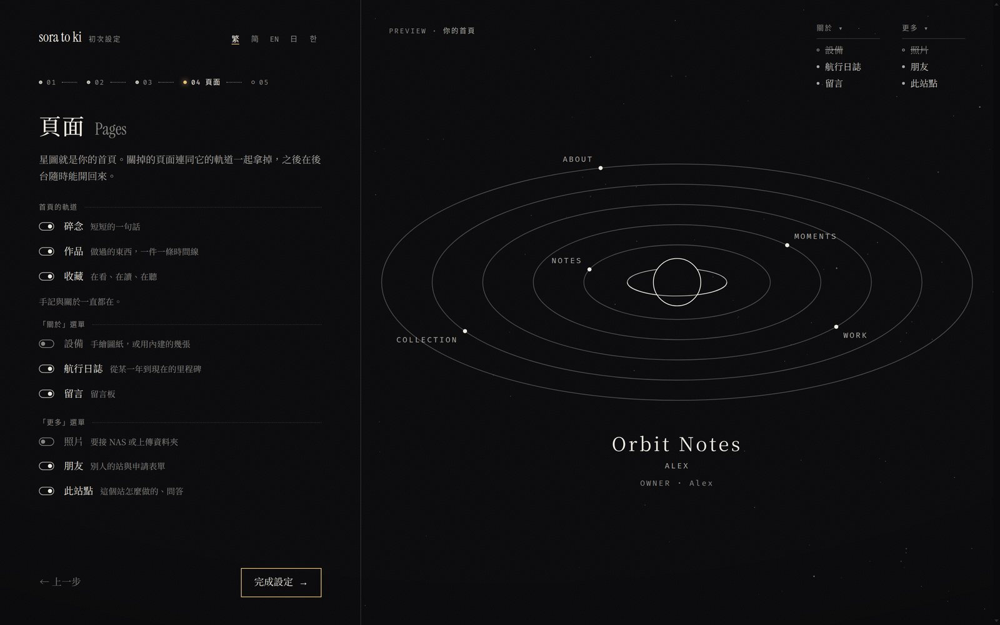
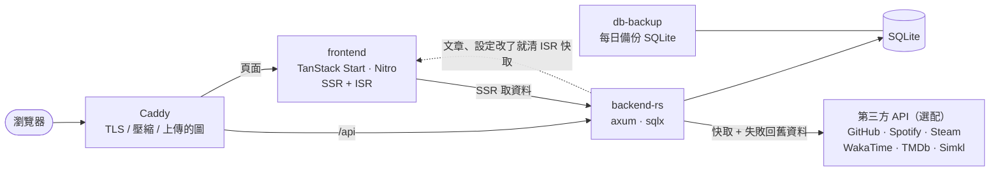

<div align="center">


# sora-to-ki

**此處無他，唯有黑夜、白墨與微光。**

一個人的網站：手記、碎念、作品、收藏與航行日誌，全部串在同一片夜空裡。<br/>
這是 [**宙と木（koimsurai.com）**](https://koimsurai.com) 的原始碼，也可以拿去架成你自己的站。

**繁體中文** · [English](README.en.md)

[**看示範站**](https://koimsurai.com) · [**架自己的站**](#️-架自己的站) · [此站點（設計說明）](https://koimsurai.com/about-site) · [Releases](https://github.com/Koimsurai/sora-to-ki/releases)

[](https://github.com/Koimsurai/sora-to-ki/actions/workflows/ci.yml)
[](https://github.com/Koimsurai/sora-to-ki/releases)
[](LICENSE)
[](https://app.codecov.io/gh/Koimsurai/sora-to-ki?flags%5B0%5D=frontend)
[](https://app.codecov.io/gh/Koimsurai/sora-to-ki?flags%5B0%5D=e2e)
[](https://app.codecov.io/gh/Koimsurai/sora-to-ki?flags%5B0%5D=backend)

[](https://react.dev/)
[](https://tanstack.com/start)
[](https://github.com/tokio-rs/axum)
[](https://sqlite.org/)
[](https://docs.docker.com/compose/)

[](https://koimsurai.com)

</div>

## 🛰️ 架自己的站

只需要一台裝了 Docker 的機器，和一個指向它的網域。

```bash
git clone https://github.com/Koimsurai/sora-to-ki.git
cd sora-to-ki
cp .env.example .env                  # 網址、網域
cp .env.backend.example .env.backend  # JWT_SECRET、GitHub 或 Google 登入
docker compose up -d
docker compose logs backend-rs | grep setup   # 初次設定的網址
```

打開 log 裡那條網址就是**初次設定精靈**：用 GitHub 或 Google 登入認領站長，選語系、填站名、決定要開哪些頁面，
右邊的軌道跟著你填的一步一步長出來。登入要用的 OAuth App 怎麼建，精靈第一步會一步一步帶你做。



- 映像是發版時建好的（[GHCR](https://github.com/Koimsurai?tab=packages&repo_name=sora-to-ki)），不必在自己機器上編譯；要從原始碼建就加 `--build`
- 內建 Caddy：`.env` 的 `CADDY_ADDRESS` 填網域會自動申請 HTTPS；在本機試跑就填 `:80`，打開 <http://localhost>。
  主機上已經有 nginx 的話，照 [`deploy/nginx/`](deploy/nginx/README.md) 改用它（override 與 server block 範例都在裡面）；
  其他反向代理照 `docker-compose.yml` 開頭的說明寫一份 `docker-compose.override.yml`
- `.env.backend` 填了 `OWNER_EMAIL` 的話不走精靈：用那個信箱登入就是站長
- 後台在 `/admin`，只能用 GitHub 或 Google 登入（`ADMIN_USERNAME`／`ADMIN_PASSWORD` 是給 MCP 用的機器帳號，不是給人登入的）
- 升級：`docker compose pull && docker compose up -d`。要固定版本就在 `.env` 設 `SORA_TO_KI_VERSION=0.2.0`
- 資料庫每天自動備份到 `./backups`

### 交給 AI 架

用 Claude Code、Codex 這類能在主機上跑指令的 AI 也可以，把下面這段貼給它（`<…>` 換成你的）：

```text
在這台主機上架 https://github.com/Koimsurai/sora-to-ki ，照 README「架自己的站」做。
網域是 <blog.example.com>，站名 <站名>，預設語系 <zh-TW>。
- .env：SITE_URL、CADDY_ADDRESS 填網域；.env.backend 的 JWT_SECRET 用 `openssl rand -hex 32` 產生
- 80／443 已經被別的服務用了的話，不要停掉它：照 docker-compose.yml 開頭的說明寫 docker-compose.override.yml
- 起來之後把 `docker compose logs backend-rs | grep setup` 那行網址給我，登入與認領我自己來
- .env、.env.backend 不要提交、不要貼到別的地方
```

登入一定要你本人來：GitHub／Google 的 OAuth App 是用你的帳號建的。
AI 能做的是把機器準備好、把設定檔填對、在你建好 OAuth App 之後把兩串值填進 `.env.backend` 並重開後端。

## ✨ 架起來會有什麼

### 同一片天空

每一頁都是同一片夜空裡的一種東西。不想要的頁面在後台關掉，它在首頁的軌道跟著拿掉。

| 頁面 | 是天空裡的 | 內容從哪來 |
|---|---|---|
| 首頁 | 繞著土星的衛星（一顆衛星一個分區） | 各頁最新的一筆 |
| 手記 | 一圈一圈的星軌，一篇文章就是一道 | 後台寫的文章 |
| 碎念 | 劃過的彗星，最新那則是彗核 | 後台寫的短篇 |
| 作品 | 往外長的螺旋航線，星球大小是程式碼量、衛星是 GitHub 星星 | 後台挑的 GitHub repo |
| 收藏 | 從地球發出的訊號：看完、讀完、聽完的那一刻發出，以光速飛到現在 | 書架、Simkl／TMDb、Spotify（都是選配） |
| 航行日誌 | 從你設的發射台升空，高度是累積的 GitHub 貢獻 | 後台填的起點與里程碑 |
| 關於 | 一次下墜，從某一年掉到現在 | 後台填的章節、技能、經歷 |
| 照片 | 從深空傳回來的照片，一行一行收下來 | NAS 或上傳的資料夾 |
| 設備 | 太空梭貨艙裡的工程圖 | 內建的圖紙，或你上傳的圖 |
| 朋友 | 繞著同一個中心的星 | 朋友頁的表單送進來，後台審 |
| 留言 | 收到的電波 | 讀者 |
| 此站點 | 一具六分儀與它量到的星 | 後台填的問答 |

### 寫

- **MDX 文章**：除了 GFM，另有二十多個自訂區塊（程式碼分頁、Diff、檔案樹、Mermaid 圖表、投票、手繪風草圖、日文振假名、劇透、站長註解…），
  全部在伺服器上編譯與上色，讀者不用下載編譯器
- **五種語系**：繁中、简中、English、日本語、한국어，預設語系自己選。每篇文章各自翻譯，简中可以從繁中自動轉；
  後台標出原文改過、還沒跟上的譯文
- **排程發佈**（到時間自動發，電子報也那時才寄）、**回收桶**（30 天內可以還原）、電子報（Resend）、RSS
- **圖片不跳版**：上傳時算出 thumbhash 和原始尺寸，載入前先顯示模糊佔位圖
- **MCP server**：[`packages/mcp-server`](packages/mcp-server) 的 31 個工具讓 AI 助手透過後台 API 寫文章、發碎念、上傳圖片、改頁面與站台設定

### 後台

- **此刻**：總覽列出等你處理的事、近 28 天的 Web Vitals
- **寫**：Monaco 編輯器（Vim 模式、斜線指令、拖放上傳）與即時預覽；碎念旁邊列出同步進來的紀錄，按一下帶進撰寫框
- **收**：書架、照片的標題與精選、收藏頁要公開哪些
- **回**：留言審核（鍵盤 j／k／a／s／r）、**友鏈申請**（一鍵檢查對方的站連得到、有沒有回連、有沒有 RSS）、電子報訂閱者
- **站**：站台設定（站名、語系、天體、發射台、各頁的介紹文字）、各頁的內容、帳號與權限
- 後台本身也有五種語言，跟著站長自己，不跟著站的預設語系

| 此刻 | 手記 |
|:---:|:---:|
|  |  |

### 其他

- GitHub／Google 登入、命令面板（`Ctrl+K`）、PWA 離線頁、每語系各自的 sitemap 與 hreflang、每一頁自己的動態分享圖、嚴格的 CSP
- 第三方整合都是選配：沒填金鑰，那一塊就不出現，不會冒錯誤
- 錯誤追蹤（Sentry 相容，例如 GlitchTip）與 Plausible 流量統計也是選配

## 🎛️ 客製化

讓你在一組精心做好的選項裡挑，而不是給一整排旋鈕：每個人的站都有一點「這是我的」，整體的質感也還在。

- **天體**：土星、海王星、黑洞、參宿四四選一，當作讀者第一次看到的那顆；讀者也能在頂欄自己換
- **發射台**：你在哪裡。航行日誌的火箭從那裡升空、地面畫那附近的海岸線（內陸的話加上河流與湖），收藏頁地球上的琥珀點也在那裡
- **頁面**：碎念、作品、收藏、設備、航行日誌、留言、照片、朋友、此站點都能關
- **介紹文字**：每一頁在搜尋結果裡的描述、「關於」選單開頭那一句，五種語言各自寫
- **設備頁的圖紙**：想用自己的手繪圖紙、讓滑過的部件整個亮起來，做一個圖紙包放進 `custom/setup/`，
  格式與交給 AI 的說法見 [`custom/setup/README.md`](custom/setup/README.md)

## 🌌 設計

整個站只有一個概念：**每一頁都是同一片夜空裡的一種東西**，用首頁那顆點線土星的點和線變出來。完整的說明（還能一步一步看土星怎麼畫出來）在示範站的 [此站點](https://koimsurai.com/about-site)。

### 只有三樣材料

| | | |
|---|---|---|
| ⬛ | **黑，是紙** | 整個站的底 |
| ⬜ | **白，是墨** | 字、線、點 |
| 🟧 | **琥珀，是訊號** | 只出現在一個點上：你在哪裡、正在發生的事。不拿來當大面積的強調色 |

### 三種字

- **思源宋體**：中文與所有混排的句子。按頁面實際用到的字裁切，一頁只下載幾十 KB
- **Instrument Serif**：只給整段英文的大字，不加粗
- **等寬字**：日期與數字

讀文章時還能換成黑體、楷體或現代無襯線，四種都照語系由站上提供。

### 三條規則

1. **一個畫面只有一個訊號**：琥珀色一次只亮一處
2. **只用點與線**：不塗色塊、不疊陰影、不用毛玻璃；直角、細線、點線分隔
3. **由數據長出來**：作品頁的星球大小是程式碼量、地貌是主要語言、衛星是 GitHub 星星

## 📸 畫面

| 手記：一圈一圈的星軌 | 文章 |
|:---:|:---:|
| [](https://koimsurai.com/blog) | [](https://koimsurai.com/blog) |
| **作品：往外長的螺旋航線** | **收藏：從地球發出的訊號** |
| [](https://koimsurai.com/portfolio) | [](https://koimsurai.com/watch) |
| **航行日誌：從地表升空** | **照片：從深空傳回來的照片** |
| [](https://koimsurai.com/history) | [](https://koimsurai.com/photos) |
| **朋友：繞著同一個中心的星** | **設備：太空梭的工程圖** |
| [](https://koimsurai.com/friends) | [](https://koimsurai.com/setup) |
| **此站點** | **後台：留言** |
| [](https://koimsurai.com/about-site) |  |

## 🏗️ 架構



- **型別只寫一次**：後端的 Rust struct 用 [specta](https://github.com/specta-rs/specta) 產生 TypeScript 型別（[`packages/api-types`](packages/api-types)），前端直接引用；CI 會檢查兩邊有沒有對上
- **第三方 API 都經過後端**：金鑰不會進前端。回應會快取，上游出錯時改回舊資料，不會整區空白
- **ISR**：頁面由 Nitro 快取，後端改到文章或站台設定時主動通知前端清除快取
- **設計 token 有檢查在擋**：間距、字級、行高、圓角、透明度…都必須用 `src/index.css` 裡的 token，`pnpm check:css-tokens` 會擋掉現編的值

## 🛠️ 技術

| | |
|---|---|
| **前端** | React 19 · TanStack Start / Router / Query · Vite+（vite、vitest、oxlint、oxfmt）· Tailwind CSS v4 · Framer Motion · three.js（WebGPU，退回 WebGL2）· MDX · @pierre/highlights · pele · rough.js · i18next · Radix UI / shadcn |
| **後端** | Rust 2024 · axum · tokio · sqlx（SQLite）· JWT · image / resvg / thumbhash（圖片與分享圖）· ferrous-opencc · utoipa（OpenAPI，`/api/docs`）· Sentry SDK |
| **字** | 思源宋體（按頁裁字）· Instrument Serif · 等寬字 |
| **基礎設施** | Docker Compose · Caddy · GitHub Actions · GHCR · Codecov |

## 🧪 品質把關

每個 PR 都要通過下面這些才能合併（完整清單在 [`.github/workflows/ci.yml`](.github/workflows/ci.yml)）：

- **型別與 lint**：`tsc`、oxlint（含型別感知規則與 `@shadcn/lint`）、Biome（CSS）、CSS token 檢查、knip（沒用到的檔案與 export）
- **測試**：vitest 單元測試、Playwright e2e（26 支 spec，含無障礙檢查、後台的往返操作，以及公開頁 11 條 × 3 種寬度加上後台頁的計算後樣式比對）、後端 cargo-nextest 搭配覆蓋率門檻
- **API**：用 OpenAPI 規格自動產生測試資料打後端（Schemathesis），並檢查回應符合宣告的 schema
- **後端**：`cargo clippy`（pedantic）、`cargo audit`、`cargo shear`、`typos`
- **效能**：Lighthouse CI 的效能預算
- **另外**（不在 CI，手動跑）：變異測試（Stryker、cargo-mutants），找出「測試有跑到、但其實沒在檢查」的地方

## ⚙️ 本機開發

需要 **Node.js ≥ 26**、**pnpm 12**、**Rust stable**（edition 2024），或者只要 Docker。

```bash
git clone https://github.com/Koimsurai/sora-to-ki.git
cd sora-to-ki
pnpm install
```

### 分開跑前後端

```bash
# 後端：讀 backend/.env
cp backend/.env.example backend/.env
#   把 DATABASE_URL 改成本機路徑，例如 sqlite://./dev.sqlite
#   把 BIND_ADDR 改成 127.0.0.1:3009（前端 dev server 預設連這個埠）
cd backend && cargo run

# 前端：http://localhost:13998
pnpm dev
```

資料庫不存在時會自動建立，schema 由 [`backend/migrations/`](backend/migrations) 在啟動時套用。

### 環境變數

必填的只有 `DATABASE_URL` 和 `JWT_SECRET`（範例檔裡都有）。其他的沒設時，對應的功能會自動關閉，或顯示空狀態。

| 用途 | 變數 |
|---|---|
| 基本 | `DATABASE_URL` `BIND_ADDR` `JWT_SECRET` `SITE_URL` |
| 登入（站長與讀者） | `GITHUB_CLIENT_ID` `GITHUB_CLIENT_SECRET` `GOOGLE_CLIENT_ID` `GOOGLE_CLIENT_SECRET` `OWNER_EMAIL` |
| MCP 的機器帳號 | `ADMIN_USERNAME` `ADMIN_PASSWORD` |
| 動態頁 | `GITHUB_TOKEN` `WAKATIME_API_KEY` `STEAM_API_KEY` `STEAM_ID` |
| Spotify | `SPOTIFY_CLIENT_ID` `SPOTIFY_CLIENT_SECRET` `SPOTIFY_REFRESH_TOKEN` `SPOTIFY_REDIRECT_URI` |
| 影劇 | `TMDB_API_TOKEN` `SIMKL_CLIENT_ID` `SIMKL_ACCESS_TOKEN`；台灣的動畫瘋：`BAHAMUT_UID` `BAHAMUT_PASSWORD` |
| 書櫃 | `GOOGLE_BOOKS_API_KEY`；台灣的國家圖書館 ISBN：`ENABLE_TW_ISBN_SYNC` |
| 電子報 | `RESEND_API_KEY` |
| 錯誤追蹤 | `SENTRY_DSN` `SENTRY_FRONTEND_DSN` |
| 後台流量（Plausible） | `PLAUSIBLE_API_KEY` `PLAUSIBLE_SITE_ID` |
| ISR 清快取 | `FRONTEND_REVALIDATE_URL` `REVALIDATE_SECRET`（compose 裡沒填會自動產生） |

### 常用指令

```bash
pnpm dev              # 前端 dev server
pnpm build            # 正式建置
pnpm test             # 單元測試
pnpm e2e              # Playwright e2e（跑的是上一次 build 的產物，改完 src/ 要先 build）
pnpm lint:css         # CSS lint（Biome）
pnpm check:css-tokens # CSS token 檢查
pnpm export:types     # 從 Rust 重新產生 TS 型別

cd backend
cargo nextest run --no-fail-fast   # 後端測試（請用 nextest，不要用 cargo test）
cargo clippy --all-targets -- -D warnings
```

### 專案結構

```
.
├── backend/                 # Rust API
│   ├── src/router.rs        # 路由表
│   ├── src/handlers/        # 依領域拆分（posts、thoughts、watch、gallery、ground…）
│   ├── data/geo/            # 航行日誌的海岸線（Natural Earth，公有領域）
│   └── migrations/          # SQLite schema
├── packages/
│   ├── api-types/           # 由 Rust 產生的 TS 型別（不要手改）
│   ├── mdx-core/            # 前後端共用的 MDX 編譯設定
│   └── mcp-server/          # 後台 API 的 MCP server
├── src/
│   ├── routes/              # TanStack Router 的檔案路由（含 $locale/ 語系前綴）
│   ├── components/          # 依功能領域分組；各頁的天空在同名的 *Sky.ts
│   ├── data/ i18n/ seo/     # API 查詢、語系路由、meta 與 JSON-LD
│   ├── hooks/ store/ lib/
│   └── locales/             # 五種語系的翻譯（後台在 locales/<語系>/admin/）
├── custom/                  # 給你改的：設備頁的圖紙包
├── server/routes/           # Nitro 路由：sitemap、robots、rss、llms.txt
├── tests/e2e/               # Playwright
├── Dockerfile
└── docker-compose.yml
```

給 AI 助手（Claude Code 等）看的工作守則在 [`CLAUDE.md`](CLAUDE.md)，裡面也記錄了很多踩過的坑和設計理由。

## 📜 沿革

- **2025-04**：開始寫，一個人的網站
- **2026-07**：後端從 Express 整套搬到 Rust，120 多個端點逐一對拍、確認回應一模一樣才切換（[`backend/STRANGLER.md`](backend/STRANGLER.md)）
- **2026-10**：照「三樣材料、三條規則」整站翻新成現在的宙と木。翻新前的最後一版留在 tag [`v1-final`](https://github.com/Koimsurai/sora-to-ki/tree/v1-final)，也還跑在 <https://archive.koimsurai.com>（唯讀）
- **2026-10**：拆掉寫死的部分，開源成誰都能架的 sora-to-ki（[v0.2.0](https://github.com/Koimsurai/sora-to-ki/releases)）

## 📄 授權與參與

- **程式碼**：[GNU Affero General Public License v3.0](LICENSE)。改過之後**架成網站對外提供**，也要以相同授權公開修改後的原始碼
- **內容**：示範站上的文章、照片、碎念、書評、頭像與 logo © Koimsurai，**保留所有權利**，不在授權範圍內
- 只是想架一個站的話，照上面「架自己的站」就好，不需要 fork
- 不接受 PR；有問題或發現 bug 都歡迎開 [issue](https://github.com/Koimsurai/sora-to-ki/issues)

## 🙏 致謝

用到的開源專案很多，特別感謝
[TanStack](https://tanstack.com/)、[axum](https://github.com/tokio-rs/axum)、[sqlx](https://github.com/launchbadge/sqlx)、
[three.js](https://threejs.org/)、[MDX](https://mdxjs.com/)、[pele](https://pele.run/)、[rough.js](https://roughjs.com/)、
[Excalifont](https://github.com/excalidraw/excalidraw)、[小賴字體](https://github.com/lxgw/kose-font)、[Radix UI](https://www.radix-ui.com/)、[shadcn/ui](https://ui.shadcn.com/)、
[OpenCC](https://github.com/BYVoid/OpenCC)、[thumbhash](https://github.com/evanw/thumbhash)、[Natural Earth](https://www.naturalearthdata.com/)、
[思源宋體](https://github.com/adobe-fonts/source-han-serif)、[Instrument Serif](https://fonts.google.com/specimen/Instrument+Serif)，
以及 [Vite+](https://viteplus.dev/) 與 oxc 的工具鏈。
