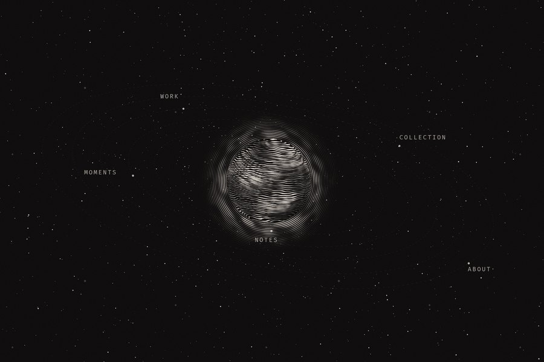
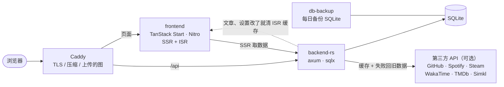

<div align="center">


# sora-to-ki

**此处无他，唯有黑夜、白墨与微光。**

一个人的网站：手记、碎念、作品、收藏与航行日志，全部串在同一片夜空里。<br/>
这是 [**宙と木（koimsurai.com）**](https://koimsurai.com) 的源代码，也可以拿去部署成你自己的站。

[English](README.md) · [繁體中文](README.zh-TW.md) · **简体中文**

[**看演示站**](https://koimsurai.com) · [**部署自己的站**](#️-部署自己的站) · [此站点（设计说明）](https://koimsurai.com/about-site) · [Releases](https://github.com/Koimsurai/sora-to-ki/releases)

[](https://github.com/Koimsurai/sora-to-ki/actions/workflows/ci.yml)
[](https://github.com/Koimsurai/sora-to-ki/releases)
[](LICENSE)
[](https://app.codecov.io/gh/Koimsurai/sora-to-ki?flags%5B0%5D=frontend)
[](https://app.codecov.io/gh/Koimsurai/sora-to-ki?flags%5B0%5D=e2e)
[](https://app.codecov.io/gh/Koimsurai/sora-to-ki?flags%5B0%5D=backend)

[](https://react.dev/)
[](https://tanstack.com/start)
[](https://github.com/tokio-rs/axum)
[](https://sqlite.org/)
[](https://docs.docker.com/compose/)

[](https://koimsurai.com/zh-cn?theme=blackhole)

</div>

## 🛰️ 部署自己的站

只需要一台装了 Docker 的机器，和一个指向它的域名。

```bash
git clone https://github.com/Koimsurai/sora-to-ki.git
cd sora-to-ki
cp .env.example .env                  # 网址、域名
cp .env.backend.example .env.backend  # JWT_SECRET、GitHub 或 Google 登录
docker compose up -d
docker compose logs backend-rs | grep setup   # 初始化的网址
```

打开 log 里那条网址就是**初始化向导**：用 GitHub 或 Google 登录认领站长，选语言、填站名、决定要开哪些页面，
右边的轨道跟着你填的一步一步长出来。登录要用的 OAuth App 怎么建，向导第一步会一步一步带你做。


- 镜像是发版时建好的（[GHCR](https://github.com/Koimsurai?tab=packages&repo_name=sora-to-ki)），不必在自己机器上编译；要从源代码建就加 `--build`
- 内置 Caddy：`.env` 的 `CADDY_ADDRESS` 填域名会自动申请 HTTPS；在本地试跑就填 `:80`，打开 <http://localhost>。
  主机上已经有 nginx 的话改用它（见下面「用主机上的 nginx」）；Traefik 这类其他反向代理用同一份 override 关掉 Caddy，
  分流照 [`deploy/nginx/sora-to-ki.conf`](deploy/nginx/sora-to-ki.conf)
- `.env.backend` 填了 `OWNER_EMAIL` 的话不走向导：用那个邮箱登录就是站长
- 后台在 `/admin`，只能用 GitHub 或 Google 登录（`ADMIN_USERNAME`／`ADMIN_PASSWORD` 是给 MCP 用的机器账号，不是给人登录的）
- 升级：`docker compose pull && docker compose up -d`。要固定版本就在 `.env` 设 `SORA_TO_KI_VERSION=0.2.1`
- 数据库每天自动备份到 `./backups`

<details>
<summary><b>用主机上的 nginx（不用内置的 Caddy）</b></summary>

前后端只对本机开端口（前端 `127.0.0.1:13579`、后端 `127.0.0.1:3002`），由 nginx 转发进来；
后台上传的文件与照片缩略图放在 repo 底下的 `storage/`，nginx 直接读。

```bash
cp deploy/nginx/docker-compose.override.yml .   # 已经有 override 的话把内容合并进去
mkdir -p storage/uploads storage/gallery
docker compose up -d                            # .env 的 SITE_URL 照填，CADDY_ADDRESS 用不到

sudo cp deploy/nginx/security-headers.conf /etc/nginx/snippets/sora-to-ki-security.conf
sudo cp deploy/nginx/sora-to-ki.conf /etc/nginx/sites-available/sora-to-ki
# 把 sora-to-ki 里的 example.com 与 /srv/sora-to-ki（这个 repo 的实际路径）改掉
sudo ln -s /etc/nginx/sites-available/sora-to-ki /etc/nginx/sites-enabled/
sudo nginx -t && sudo systemctl reload nginx
sudo certbot --nginx -d example.com             # HTTPS
```

`storage/` 读不到（403）的话，检查从 `/` 到 `storage/uploads` 的每一层目录，nginx 的用户（多半是 `www-data`）都要有 `x` 权限。

</details>

### 交给 AI 部署

用 Claude Code、Codex 这类能在主机上跑命令的 AI 也可以，把下面这段贴给它（`<…>` 换成你的）：

```text
在这台主机上部署 https://github.com/Koimsurai/sora-to-ki ，照 README.zh-CN.md 的「部署自己的站」做。
域名是 <blog.example.com>，站名 <站名>，默认语言 <zh-TW>。
- .env：SITE_URL、CADDY_ADDRESS 填域名；.env.backend 的 JWT_SECRET 用 `openssl rand -hex 32` 生成
- 80／443 已经被别的服务用了的话，不要停掉它：照 deploy/nginx/README.md 改用主机上的反向代理
- 起来之后把 `docker compose logs backend-rs | grep setup` 那行网址给我，登录与认领我自己来
- .env、.env.backend 不要提交、不要贴到别的地方
```

登录一定要你本人来：GitHub／Google 的 OAuth App 是用你的账号建的。
AI 能做的是把机器准备好、把配置文件填对、在你建好 OAuth App 之后把两串值填进 `.env.backend` 并重启后端。

## ✨ 部署之后会有什么

### 同一片天空

每一页都是同一片夜空里的一种东西。不想要的页面在后台关掉，它在首页的轨道跟着拿掉。

| 页面 | 是天空里的 | 内容从哪来 |
|---|---|---|
| 首页 | 绕着土星的卫星（一颗卫星一个分区） | 各页最新的一笔 |
| 手记 | 一圈一圈的星轨，一篇文章就是一道 | 后台写的文章 |
| 碎念 | 划过的彗星，最新那则是彗核 | 后台写的短篇 |
| 作品 | 往外长的螺旋航线，星球大小是代码量、卫星是 GitHub 星星 | 后台挑的 GitHub repo |
| 收藏 | 从地球发出的信号：看完、读完、听完的那一刻发出，以光速飞到现在 | 书架、Simkl／TMDb、Spotify（都是可选） |
| 航行日志 | 从你设的发射台升空，高度是累积的 GitHub 贡献 | 后台填的起点与里程碑 |
| 关于 | 一次下坠，从某一年掉到现在 | 后台填的章节、技能、经历 |
| 照片 | 从深空传回来的照片，一行一行收下来 | NAS 或上传的文件夹 |
| 设备 | 航天飞机货舱里的工程图 | 内置的图纸，或你上传的图 |
| 朋友 | 绕着同一个中心的星 | 朋友页的表单送进来，后台审 |
| 留言 | 收到的电波 | 读者 |
| 此站点 | 一具六分仪与它量到的星 | 后台填的问答 |

### 写

- **MDX 文章**：除了 GFM，另有二十多个自定义区块（代码标签页、Diff、文件树、Mermaid 图表、投票、手绘风草图、日文振假名、剧透、站长注解…），
  全部在服务器上编译与上色，读者不用下载编译器
- **五种语言**：繁中、简中、English、日本语、한국어，默认语言自己选。每篇文章各自翻译，简中可以从繁中自动转；
  后台标出原文改过、还没跟上的译文
- **定时发布**（到时间自动发，邮件订阅也那时才寄）、**回收站**（30 天内可以还原）、邮件订阅（Resend）、RSS
- **图片不跳版**：上传时算出 thumbhash 和原始尺寸，加载前先显示模糊占位图
- **MCP server**：[`packages/mcp-server`](packages/mcp-server) 的 31 个工具让 AI 助手通过后台 API 写文章、发碎念、上传图片、改页面与站点设置

### 后台

- **此刻**：总览列出等你处理的事、近 28 天的 Web Vitals
- **写**：Monaco 编辑器（Vim 模式、斜线命令、拖放上传）与实时预览；碎念旁边列出同步进来的记录，按一下带进编写框
- **收**：书架、照片的标题与精选、收藏页要公开哪些
- **回**：留言审核（键盘 j／k／a／s／r）、**友链申请**（一键检查对方的站连得到、有没有回连、有没有 RSS）、邮件订阅者
- **站**：站点设置（站名、语言、天体、发射台、各页的介绍文字）、各页的内容、账号与权限
- 后台本身也有五种语言，跟着站长自己，不跟着站的默认语言

| 此刻 | 手记 |
|:---:|:---:|
|  |  |

### 其他

- GitHub／Google 登录、命令面板（`Ctrl+K`）、PWA 脱机页、每语言各自的 sitemap 与 hreflang、每一页自己的动态分享图、严格的 CSP
- 第三方集成都是可选：没填密钥，那一块就不出现，不会冒错误
- 错误追踪（Sentry 兼容，例如 GlitchTip）与 Plausible 流量统计也是可选

## 🎛️ 自定义

让你在一组精心做好的选项里挑，而不是给一整排旋钮：每个人的站都有一点「这是我的」，整体的质感也还在。

### 四套星球主题

挑一颗当作读者第一次看到的那颗，读者也能在顶栏自己换。首页、全站的配色与分享图都跟着它。

| | |
|:---:|:---:|
| [](https://koimsurai.com/zh-cn?theme=saturn) | [](https://koimsurai.com/zh-cn?theme=neptune) |
| **土星** · *以冰为环，终将归还。* | **海王星** · *未见其形，已知其所在。* |
| [](https://koimsurai.com/zh-cn?theme=blackhole) | [](https://koimsurai.com/zh-cn?theme=betelgeuse) |
| **黑洞** · *光亦折返，时间止步。* | **参宿四** · *吐纳之间，渐成星尘。* |

### 其他

- **发射台**：你在哪里。航行日志的火箭从那里升空、地面画那附近的海岸线（内陆的话加上河流与湖），收藏页地球上的琥珀点也在那里
- **页面**：碎念、作品、收藏、设备、航行日志、留言、照片、朋友、此站点都能关
- **介绍文字**：每一页在搜索结果里的描述、「关于」菜单开头那一句，五种语言各自写
- **设备页的图纸**：想用自己的手绘图纸、让滑过的部件整个亮起来，做一个图纸包放进 `custom/setup/`，
  格式与交给 AI 的说法见 [`custom/setup/README.md`](custom/setup/README.md)

## 🌌 设计

整个站只有一个概念：**每一页都是同一片夜空里的一种东西**，用首页那颗点线土星的点和线变出来。完整的说明（还能一步一步看土星怎么画出来）在演示站的 [此站点](https://koimsurai.com/about-site)。

### 只有三样材料

| | | |
|---|---|---|
| ⬛ | **黑，是纸** | 整个站的底 |
| ⬜ | **白，是墨** | 字、线、点 |
| 🟧 | **琥珀，是信号** | 只出现在一个点上：你在哪里、正在发生的事。不拿来当大面积的强调色 |

### 三种字

- **思源宋体**：中文与所有混排的句子。按页面实际用到的字裁切，一页只下载几十 KB
- **Instrument Serif**：只给整段英文的大字，不加粗
- **等宽字**：日期与数字

读文章时还能换成黑体、楷体或现代无衬线，四种都照语言由站上提供。

### 三条规则

1. **一个画面只有一个信号**：琥珀色一次只亮一处
2. **只用点与线**：不涂色块、不叠阴影、不用毛玻璃；直角、细线、点线分隔
3. **由数据长出来**：作品页的星球大小是代码量、地貌是主要语言、卫星是 GitHub 星星

## 📸 画面

| 手记：一圈一圈的星轨 | 文章 |
|:---:|:---:|
| [](https://koimsurai.com/blog) | [](https://koimsurai.com/blog) |
| **作品：往外长的螺旋航线** | **收藏：从地球发出的信号** |
| [](https://koimsurai.com/portfolio) | [](https://koimsurai.com/watch) |
| **航行日志：从地表升空** | **照片：从深空传回来的照片** |
| [](https://koimsurai.com/history) | [](https://koimsurai.com/photos) |
| **朋友：绕着同一个中心的星** | **设备：航天飞机的工程图** |
| [](https://koimsurai.com/friends) | [](https://koimsurai.com/setup) |
| **此站点** | **后台：留言** |
| [](https://koimsurai.com/about-site) |  |

## 🏗️ 架构



- **类型只写一次**：后端的 Rust struct 用 [specta](https://github.com/specta-rs/specta) 生成 TypeScript 类型（[`packages/api-types`](packages/api-types)），前端直接引用；CI 会检查两边有没有对上
- **第三方 API 都经过后端**：密钥不会进前端。响应会缓存，上游出错时改回旧数据，不会整区空白
- **ISR**：页面由 Nitro 缓存，后端改到文章或站点设置时主动通知前端清除缓存
- **设计 token 有检查在挡**：间距、字号、行高、圆角、透明度…都必须用 `src/index.css` 里的 token，`pnpm check:css-tokens` 会挡掉现编的值

## 🛠️ 技术

| | |
|---|---|
| **前端** | React 19 · TanStack Start / Router / Query · Vite+（vite、vitest、oxlint、oxfmt）· Tailwind CSS v4 · Framer Motion · three.js（WebGPU，退回 WebGL2）· MDX · @pierre/highlights · pele · rough.js · i18next · Radix UI / shadcn |
| **后端** | Rust 2024 · axum · tokio · sqlx（SQLite）· JWT · image / resvg / thumbhash（图片与分享图）· ferrous-opencc · utoipa（OpenAPI，`/api/docs`）· Sentry SDK |
| **字** | 思源宋体（按页裁字）· Instrument Serif · 等宽字 |
| **基础设施** | Docker Compose · Caddy · GitHub Actions · GHCR · Codecov |

## 🧪 质量把关

每一次改动都要通过下面这些才能合并（完整清单在 [`.github/workflows/ci.yml`](.github/workflows/ci.yml)）：

- **类型与 lint**：`tsc`、oxlint（含类型感知规则与 `@shadcn/lint`）、Biome（CSS）、CSS token 检查、knip（没用到的文件与 export）
- **测试**：vitest 单元测试、Playwright e2e（26 支 spec，含无障碍检查、后台的往返操作，以及公开页 11 条 × 3 种宽度加上后台页的计算后样式比对）、后端 cargo-nextest 搭配覆盖率门槛
- **API**：用 OpenAPI 规范自动生成测试数据打后端（Schemathesis），并检查响应符合声明的 schema
- **后端**：`cargo clippy`（pedantic）、`cargo audit`、`cargo shear`、`typos`
- **性能**：Lighthouse CI 的性能预算
- **另外**（不在 CI，手动跑）：变异测试（Stryker、cargo-mutants），找出「测试有跑到、但其实没在检查」的地方

## ⚙️ 本地开发

需要 **Node.js ≥ 26**、**pnpm 12**、**Rust stable**（edition 2024），或者只要 Docker。

```bash
git clone https://github.com/Koimsurai/sora-to-ki.git
cd sora-to-ki
pnpm install
```

### 分开跑前后端

```bash
# 后端：读 backend/.env
cp backend/.env.example backend/.env
#   把 DATABASE_URL 改成本地路径，例如 sqlite://./dev.sqlite
#   把 BIND_ADDR 改成 127.0.0.1:3009（前端 dev server 默认连这个端口）
cd backend && cargo run

# 前端：http://localhost:13998
pnpm dev
```

数据库不存在时会自动创建，schema 由 [`backend/migrations/`](backend/migrations) 在启动时应用。

### 环境变量

必填的只有 `DATABASE_URL` 和 `JWT_SECRET`（示例文件里都有）。其他的没设时，对应的功能会自动关闭，或显示空状态。

| 用途 | 变量 |
|---|---|
| 基本 | `DATABASE_URL` `BIND_ADDR` `JWT_SECRET` `SITE_URL` |
| 登录（站长与读者） | `GITHUB_CLIENT_ID` `GITHUB_CLIENT_SECRET` `GOOGLE_CLIENT_ID` `GOOGLE_CLIENT_SECRET` `OWNER_EMAIL` |
| MCP 的机器账号 | `ADMIN_USERNAME` `ADMIN_PASSWORD` |
| 动态页 | `GITHUB_TOKEN` `WAKATIME_API_KEY` `STEAM_API_KEY` `STEAM_ID` |
| Spotify | `SPOTIFY_CLIENT_ID` `SPOTIFY_CLIENT_SECRET` `SPOTIFY_REFRESH_TOKEN` `SPOTIFY_REDIRECT_URI` |
| 影视 | `TMDB_API_TOKEN` `SIMKL_CLIENT_ID` `SIMKL_ACCESS_TOKEN`；台湾的动画疯：`BAHAMUT_UID` `BAHAMUT_PASSWORD` |
| 书柜 | `GOOGLE_BOOKS_API_KEY`；台湾 NCL 的 ISBN 数据：`ENABLE_TW_ISBN_SYNC` |
| 邮件订阅 | `RESEND_API_KEY` |
| 错误追踪 | `SENTRY_DSN` `SENTRY_FRONTEND_DSN` |
| 后台流量（Plausible） | `PLAUSIBLE_API_KEY` `PLAUSIBLE_SITE_ID` |
| ISR 清缓存 | `FRONTEND_REVALIDATE_URL` `REVALIDATE_SECRET`（compose 里没填会自动生成） |

### 常用命令

```bash
pnpm dev              # 前端 dev server
pnpm build            # 生产构建
pnpm test             # 单元测试
pnpm e2e              # Playwright e2e（跑的是上一次 build 的产物，改完 src/ 要先 build）
pnpm lint:css         # CSS lint（Biome）
pnpm check:css-tokens # CSS token 检查
pnpm export:types     # 从 Rust 重新生成 TS 类型

cd backend
cargo nextest run --no-fail-fast   # 后端测试（请用 nextest，不要用 cargo test）
cargo clippy --all-targets -- -D warnings
```

### 项目结构

```
.
├── backend/                 # Rust API
│   ├── src/router.rs        # 路由表
│   ├── src/handlers/        # 依领域拆分（posts、thoughts、watch、gallery、ground…）
│   ├── data/geo/            # 航行日志的海岸线（Natural Earth，公有领域）
│   └── migrations/          # SQLite schema
├── packages/
│   ├── api-types/           # 由 Rust 生成的 TS 类型（不要手改）
│   ├── mdx-core/            # 前后端共用的 MDX 编译设置
│   └── mcp-server/          # 后台 API 的 MCP server
├── src/
│   ├── routes/              # TanStack Router 的文件路由（含 $locale/ 语言前缀）
│   ├── components/          # 依功能领域分组；各页的天空在同名的 *Sky.ts
│   ├── data/ i18n/ seo/     # API 查询、语言路由、meta 与 JSON-LD
│   ├── hooks/ store/ lib/
│   └── locales/             # 五种语言的翻译（后台在 locales/<语言>/admin/）
├── custom/                  # 给你改的：设备页的图纸包
├── server/routes/           # Nitro 路由：sitemap、robots、rss、llms.txt
├── tests/e2e/               # Playwright
├── Dockerfile
└── docker-compose.yml
```

给 AI 助手（Claude Code 等）看的工作守则在 [`CLAUDE.md`](CLAUDE.md)，里面也记录了很多踩过的坑和设计理由。

## 📜 沿革

- **2025-04**：开始写，一个人的网站
- **2026-07**：后端从 Express 整套搬到 Rust，120 多个端点逐一对拍、确认响应一模一样才切换（[`backend/STRANGLER.md`](backend/STRANGLER.md)）
- **2026-10**：照「三样材料、三条规则」整站翻新成现在的宙と木。翻新前的最后一版留在 tag [`v1-final`](https://github.com/Koimsurai/sora-to-ki/tree/v1-final)，也还跑在 <https://archive.koimsurai.com>（只读）
- **2026-10**：拆掉写死的部分，开源成谁都能部署的 sora-to-ki（[v0.2.0](https://github.com/Koimsurai/sora-to-ki/releases)）

## 📄 授权与参与

- **代码**：[GNU Affero General Public License v3.0](LICENSE)。改过之后**部署成网站对外提供**，也要以相同授权公开修改后的源代码
- **内容**：演示站上的文章、照片、碎念、书评、头像与 logo © Koimsurai，**保留所有权利**，不在授权范围内
- 只是想搭一个站的话，照上面「部署自己的站」就好，不需要 fork
- 不接受 PR；有问题或发现 bug 都欢迎开 [issue](https://github.com/Koimsurai/sora-to-ki/issues)

## 🙏 致谢

用到的开源项目很多，特别感谢
[TanStack](https://tanstack.com/)、[axum](https://github.com/tokio-rs/axum)、[sqlx](https://github.com/launchbadge/sqlx)、
[three.js](https://threejs.org/)、[MDX](https://mdxjs.com/)、[pele](https://pele.run/)、[rough.js](https://roughjs.com/)、
[Excalifont](https://github.com/excalidraw/excalidraw)、[小赖字体](https://github.com/lxgw/kose-font)、[Radix UI](https://www.radix-ui.com/)、[shadcn/ui](https://ui.shadcn.com/)、
[OpenCC](https://github.com/BYVoid/OpenCC)、[thumbhash](https://github.com/evanw/thumbhash)、[Natural Earth](https://www.naturalearthdata.com/)、
[思源宋体](https://github.com/adobe-fonts/source-han-serif)、[Instrument Serif](https://fonts.google.com/specimen/Instrument+Serif)，
以及 [Vite+](https://viteplus.dev/) 与 oxc 的工具链。
